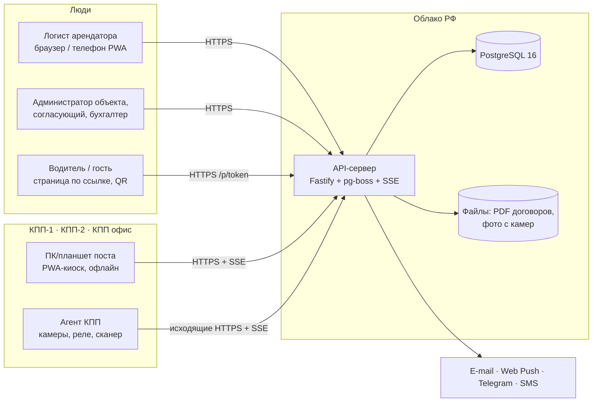
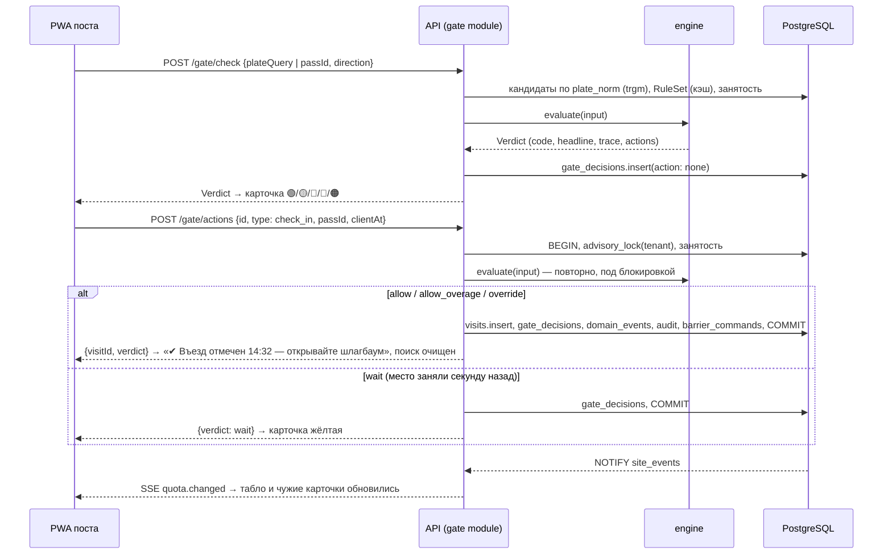
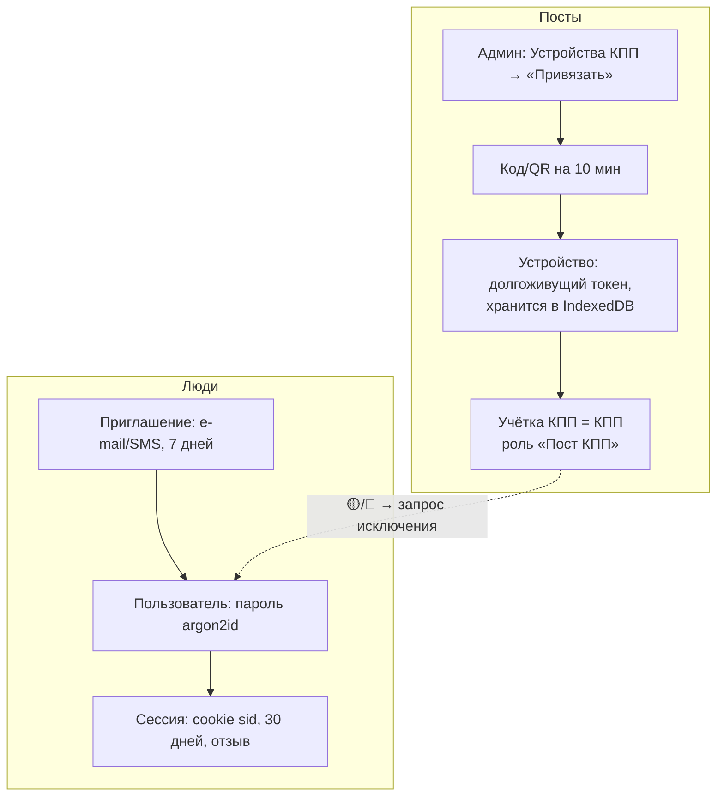
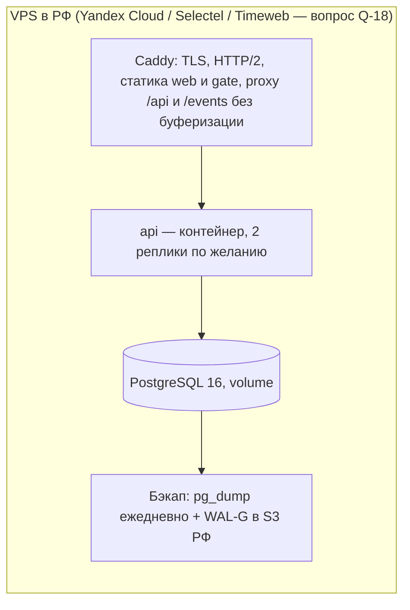

# Архитектура платформы

Короткая версия: **один Node-процесс API + PostgreSQL**, три фронтенда (веб-кабинет с админкой, PWA поста, публичная страница водителя внутри веба), общий пакет движка вердикта, и агент КПП для оборудования. Всё на TypeScript (ADR-001). Детали решений — в `docs/adr/`, модель данных — `DATA_MODEL.md`, движок — `RULES_ENGINE.md`, термины — `GLOSSARY.md`.

## 1. Контекст



## 2. Компоненты

| Компонент | Где | Что делает | Ключевые решения |
|---|---|---|---|
| **API-сервер** | `apps/api` | REST + OpenAPI, SSE, фоновые задачи (pg-boss), транзакции въезда, аудит, уведомления, файлы | ADR-001, 003, 004, 006, 007 |
| **Движок вердикта** | `packages/engine` | `evaluate(input) → Verdict` — чистые функции, одинаковые на сервере и на посту | RULES_ENGINE.md, ADR-009 |
| **Номера** | `packages/plates` | нормализация, форматы стран, нечёткое совпадение | `10_` §4 |
| **Контракты** | `packages/contracts` | zod-схемы API, события, коды ошибок и прав, настройки | ADR-001, 007 |
| **БД** | `packages/db` | Drizzle-схема, миграции, сид, RLS, тестовый harness | ADR-003, 010 |
| **Веб: админка + кабинет арендатора** | `apps/web` | один SPA, маршруты по правам: `/admin/*`, `/t/:tenantId/*`, публичная `/p/:token` (водитель), `/invite/:token` | ADR-002 |
| **PWA поста охраны** | `apps/gate` | киоск: поиск, вердикт-светофор, табло, запросы, офлайн-очередь | ADR-005, `07_` |
| **Агент КПП** | `apps/gate-agent` | адаптеры камер/реле/сканеров/СКУД, симуляторы; после MVP | ADR-008 |
| **Оборудование: контракты и симуляторы** | `packages/hardware` | типы событий/команд, интерфейсы адаптеров, `sim-camera`, `sim-barrier` | ADR-008 |
| **UI-кит** | `packages/ui` | shadcn-компоненты, токены, форматирование времени в поясе объекта | ADR-009 |

### Внутри API

```
apps/api/src/
├─ app.ts                 сборка Fastify: плагины, хуки (requestId, auth, permission, org-scope), ошибки, OpenAPI
├─ plugins/               db (пул + tx с SET LOCAL), sse, clock, files, mailer, push, telegram, sms, boss
├─ modules/               по агрегатам; в каждом routes.ts (zod-схемы из contracts) + service.ts + queries.ts
│  ├─ auth/               сессии, приглашения, коды входа, устройства и привязка
│  ├─ org/                организация, объекты, зоны, КПП, доки, справочники, настройки
│  ├─ tenants/            арендаторы, договоры, назначения, пользователи арендатора, правила пешеходов, автопарк
│  ├─ rules/              квоты, маршруты, окна, исключения, политики согласования, песочница
│  ├─ passes/             CRUD, пакет, согласование, заявки на изменение, токены водителя
│  ├─ gate/               check, check-in/out, refuse, redirect, undo, requests, override-requests, queue, sync, снимок для офлайна
│  ├─ occupancy/          табло, виджет квот, монитор
│  ├─ hardware/           устройства, события, команды, реестр, симуляторы
│  ├─ notifications/      диспетчер outbox → каналы, предпочтения
│  ├─ reports/            сверхлимиты, время на территории, отказы, экспорт XLSX
│  ├─ import/             импорт из выгрузок PASS24
│  └─ audit/              журнал аудита, журнал КПП
├─ jobs/                  pg-boss: dispatch-events, overage-charges, expire-passes, retention, contract-reminders, acs-sync
└─ test/                  permissions.matrix.ts, фикстуры сида, harness БД
```

Правила слоя:
- Маршрут объявляет `config.permission` (ADR-007) и zod-схемы запроса/ответа; из них же — OpenAPI (`/docs` только в dev).
- Сервис получает `ctx` (`{organizationId, siteId?, actor, clock, tx}`); всё, что меняет данные, выполняется в `db.transaction(ctx, async tx => { …; tx.audit(…); tx.emit(…) })`.
- Ошибки — `AppError(code, message, {field, settingLink})` → HTTP `{code, message, field, settingLink, requestId}`; коды и русские тексты — в `contracts/errors.ts`. Непредвиденное — `500 internal` с `requestId`, подробности только в логах.
- Валидация номеров и времени — одинаково на клиенте и сервере через те же схемы `contracts`.

## 3. Главные потоки

### 3.1 Проверка и въезд на КПП



### 3.2 Создание пропуска арендатором

1. Форма в кабинете подгружает «подсказки» (`GET /tenants/{id}/pass-hints?category=…&type=…`): маршрут («Фура → КПП-2»), текущая занятость («Грузовые 25/25 — машина будет ждать»), политика согласования («уйдёт директору ЛЦ»), обязательность дока и окна. Подсказки считаются тем же `engine` в режиме «предпросмотр» (`evaluate` с `now = window_from`).
2. `POST /passes` (или `POST /passes:batch` для пакета): нормализация номера, проверка дублей (exclusion-constraint), политика согласования → статус `approved` или `pending_approval`; событие и аудит.
3. Токен страницы водителя создаётся сразу; ссылка — в ответе и в уведомлении.

### 3.3 Машина без пропуска, запрос исключения, очередь

- `gate_request` → событие → push/Telegram ответственному арендатора → `approve` создаёт пропуск (политика «охрана → разовый = on_request») → событие → карточка на посту зелёная (сценарий 15, ≤ 10 с).
- `override_request` → администратору с правом `gate.override` → `approve` → карточка зелёная (сценарий 42). ADR-007.
- Очередь у ворот: `wait` по квоте ставит пропуск в `gate_queue`; `visit.closed` того же арендатора → задача находит первого в очереди → событие `queue.slot_freed` только тому посту, где он стоит, со звуком (сценарий 40).

### 3.4 Realtime, офлайн, оборудование

- Realtime: outbox `domain_events` → `NOTIFY` → SSE с `Last-Event-ID` (ADR-004).
- Офлайн поста: снимок правил, пропусков и открытых визитов в IndexedDB; очередь действий с идемпотентными id; при синхронизации «факт важнее квоты» с флагами и уведомлением (ADR-005).
- Оборудование: агент КПП с адаптерами; события вверх, команды вниз; шлагбаум — только из транзакции въезда (ADR-008, RULES_ENGINE §8).

## 4. Вход, учётки, устройства



- Пользователи арендатора и оператора — одна таблица `users`, различаются назначениями ролей (ADR-007). Один человек — несколько арендаторов.
- Учётка КПП одна на пост; устройств у неё несколько, каждое отзывается отдельно (A11). После перезагрузки ПК киоск открывается в своей учётке (сценарий 44). Отметка смены и PIN старшего — настройки объекта, выключены.
- Права атомарны, проверяются хуком на каждом маршруте, покрыты тест-матрицей (B12). Администратор объекта не имеет `visit.check_in` (A7, сценарий 39).

## 5. Мультиарендность

- Иерархия: платформа → организация (оператор) → объект → арендатор. Каждая строка несёт `organization_id`; запросы фильтруются явно, RLS — вторая линия (`DATA_MODEL.md` §4).
- Справочники (категории) — уровня организации с переопределением на объекте. Квоты, маршруты, исключения, политики — уровня объекта (с переопределением для арендатора).
- Оператор объекта — тоже арендатор (`is_operator`), без квот (A6).
- Платформенный уровень (супер-админ, биллинг, несколько организаций) — отдельная роль `platform_admin` вне организаций; в MVP только создание организации сидом/скриптом.

## 6. Аудит, события, уведомления

- **Аудит** (`audit_log`): каждое изменение бизнес-сущности — `diff` было → стало с подписями значений, актор (пользователь / учётка КПП + устройство / система / агент), `request_id`, причина там, где она обязательна (правка пропуска после начала, исключения, выезд с отметкой, отмена действия). Пишется в той же транзакции. Роль приложения не имеет `UPDATE/DELETE` на журнал.
- **Снимки**: `visits.snapshot`, `gate_decisions.snapshot`, `gate_passages.snapshot` — названия арендатора, категории, КПП, дока на момент события; переименование не трогает историю (сценарий 21).
- **События** (`domain_events`) — единственный источник для SSE, уведомлений, вебхуков (v2), очереди у ворот.
- **Уведомления**: задача `dispatch-events` читает outbox, применяет `notification_preferences` и права (кто имеет право видеть событие), создаёт `notifications` и отправляет каналами: e-mail (nodemailer, SMTP РФ-провайдера), Web Push (VAPID), Telegram (grammY, привязка по коду). SMS — только приглашения и коды входа. Повторы и статусы — в `notifications`.

## 7. Деплой в РФ и 152-ФЗ



- **Прод-окружение** — Docker Compose на одном VPS (там Docker есть; в сессии разработки — нет, ADR-010): `caddy`, `api`, `postgres`, `backup`. Образ API — многостадийный `Dockerfile` (pnpm deploy → node:22-slim). Миграции — отдельная команда перед стартом. Статика `web` и `gate` собирается в CI и копируется в образ Caddy.
- **CI/CD**: GitHub Actions — typecheck, lint, unit, интеграция с Postgres-сервисом, E2E (Playwright) на PR; деплой — по тегу, `docker compose pull && up -d` по SSH.
- **Мониторинг**: Sentry (self-hosted или РФ-аналог), `/healthz` (БД, LISTEN-соединение, pg-boss), логи pino → journald/Loki. Доступность 99,5 % рабочего времени достигается одним VPS с бэкапами; HA — не в MVP.
- **152-ФЗ** (B11):
  - серверы и бэкапы — только в РФ; провайдеры почты/SMS/push — с хранением данных в РФ (Web Push: сервис браузера получает только зашифрованный payload без ПДн — в payload только тип события и id);
  - согласие на обработку ПДн: при принятии приглашения (чекбокс + текст политики), на странице водителя (`pass_tokens.consent_at` до показа данных), в договоре с оператором — поручение на обработку (оператор — оператор ПДн, платформа — обработчик);
  - минимизация: в технических логах нет ФИО, телефонов, номеров (редакция pino по путям `*.phone`, `*.person_name`, `*.plate_raw`), в `domain_events.payload` — только id и короткие метки;
  - сроки хранения — настройка объекта (`retentionDays.*`), задача `retention` обезличивает визиты и удаляет фото;
  - доступ: роли, журнал аудита входов, отзыв сессий и устройств; пароли argon2id; TLS везде;
  - уведомление РКН об обработке ПДн подаёт оператор (ООО «Интеграция») — в чек-листе пилота; политика обработки — страница `/privacy` объекта.

## 8. Среда разработки

- Облачная сессия: `pnpm install && pnpm db:up && pnpm db:migrate && pnpm db:seed && pnpm dev`. Postgres — системный кластер, Docker недоступен (ADR-010). Команды будут вписаны в `CLAUDE.md` на этапе 1.
- Тесты: `pnpm test:unit` (без БД), `pnpm test` (с БД), `pnpm test:e2e` (Playwright, Chromium предустановлен).
- Любая сессия — своя ветка, результат в `main` через PR; CI повторяет те же команды.

## 9. Нефункциональные требования → как достигаются

| Требование (`13_`) | Решение |
|---|---|
| Вердикт ≤ 300 мс | RuleSet в памяти (кэш 5 с), занятость по partial-индексу, движок — микросекунды; одна транзакция, один round-trip к БД в `checkIn` |
| Поиск ≤ 200 мс на 100 тыс. пропусков | `gin (plate_norm gin_trgm_ops)` + фильтр по `site_id, status`; поиск только по действующим |
| Офлайн поста ≥ 8 ч | снимок в IndexedDB, очередь действий, движок локально (ADR-005) |
| Аудит неизменяемый, ≥ 3 лет | insert-only роль, партиционирование по месяцу с этапа отчётов, срок — настройка |
| Доступность 99,5 % / 24/7 для X5 | один VPS + бэкапы + мониторинг; пост работает офлайн при простое сервера |
| Права на сервере | хук `permission` на каждом маршруте + тест-матрица |
| Время в поясе объекта, тесты на пояс | ADR-009 |
| Русский интерфейс, единый словарь | `GLOSSARY.md`, тексты ошибок в `contracts` |
