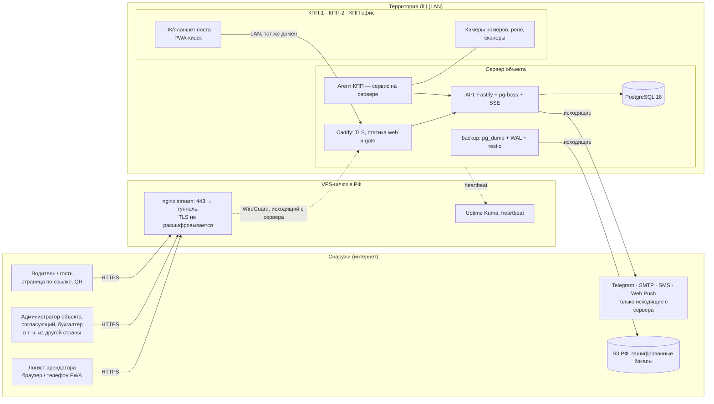
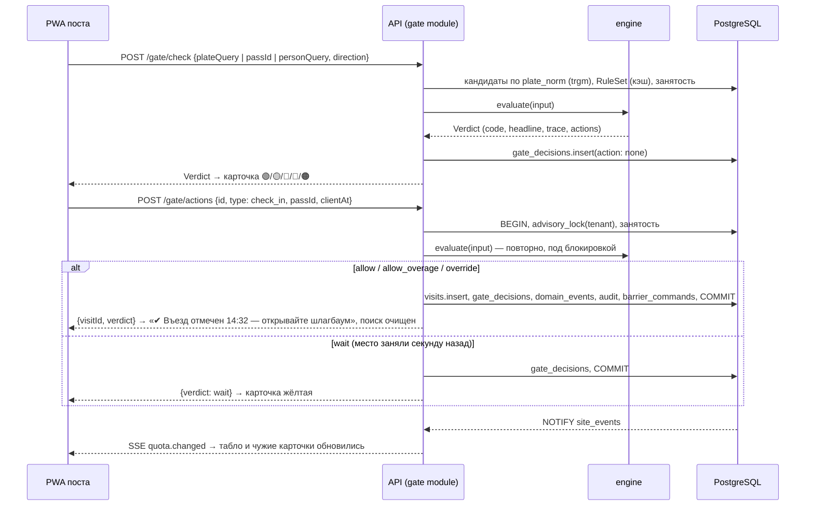
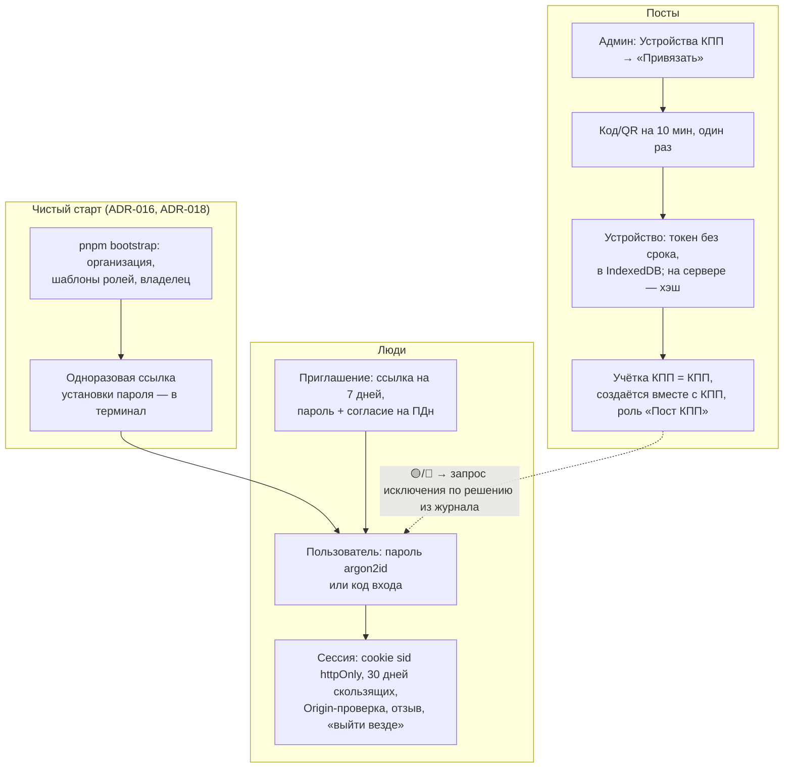
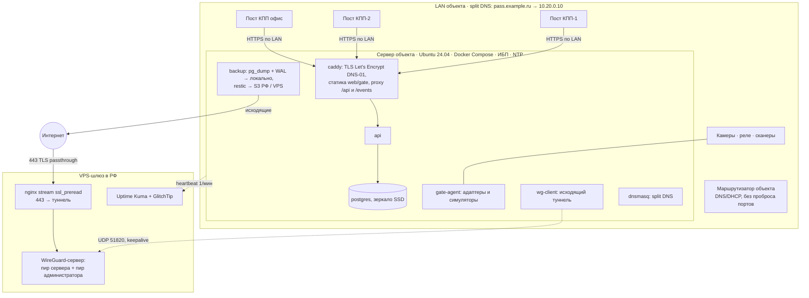

# Архитектура платформы

Короткая версия: **один Node-процесс API + PostgreSQL**, три фронтенда (веб-кабинет с админкой, PWA поста, публичная страница водителя внутри веба), общий пакет движка вердикта, и агент КПП для оборудования. Всё на TypeScript (ADR-001). Детали решений — в `docs/adr/`, модель данных — `DATA_MODEL.md`, движок — `RULES_ENGINE.md`, термины — `GLOSSARY.md`.

## 1. Контекст

Основной режим развёртывания — **сервер на территории объекта** (ADR-011). Посты и оборудование КПП работают с ним по локальной сети и не зависят от интернета; арендаторы и администратор приходят извне через VPS-шлюз (или белый IP). Облако — второй режим того же дистрибутива.



## 2. Компоненты

| Компонент | Где | Что делает | Ключевые решения |
|---|---|---|---|
| **API-сервер** | `apps/api` | REST + OpenAPI, SSE, фоновые задачи (pg-boss), транзакции въезда, аудит, уведомления, файлы | ADR-001, 003, 004, 006, 007 |
| **Движок вердикта** | `packages/engine` | `evaluate(input) → Verdict` — чистые функции, одинаковые на сервере и на посту | RULES_ENGINE.md, ADR-009 |
| **Номера** | `packages/plates` | нормализация, форматы стран, нечёткое совпадение | `10_` §4 |
| **Контракты** | `packages/contracts` | zod-схемы API, события, коды ошибок и прав, настройки | ADR-001, 007 |
| **БД** | `packages/db` | Drizzle-схема, миграции, сид, RLS, тестовый harness | ADR-003, 010 |
| **Веб: админка + кабинет арендатора** | `apps/web` | один SPA, маршруты по правам: `/admin/*`, `/t/:tenantId/*`, публичная `/p/:token` (водитель), `/invite/:token` | ADR-002 |
| **PWA поста охраны** | `apps/gate` | киоск: поиск, вердикт-светофор, табло, запросы, офлайн-очередь | ADR-005, `07_` |
| **Агент КПП** | `apps/gate-agent` | адаптеры камер/реле/сканеров/СКУД, симуляторы; после MVP | ADR-008 |
| **Оборудование: контракты и симуляторы** | `packages/hardware` | типы событий/команд, интерфейсы адаптеров, `sim-camera`, `sim-barrier` | ADR-008 |
| **UI-кит** | `packages/ui` | shadcn-компоненты, токены, форматирование времени в поясе объекта | ADR-009 |
| **Дистрибутив** | `deploy/` | `compose.yml` с профилями `onsite`/`cloud`, `oxranactl`, конфиг VPS-шлюза, INSTALL/RESTORE | ADR-011 |

### Внутри API

```
apps/api/src/
├─ app.ts                 сборка Fastify: хук прав, ошибки, OpenAPI, зависимости сервисов (deps), модули
├─ actor.ts, clock.ts     актор, его назначения и право в области (ADR-017, ADR-018), инжектируемые часы (ADR-009)
├─ auth/                  argon2id и токены, cookie, проверка Origin (CSRF), журнал входа и ограничение попыток, актор из сессии и токена устройства (ADR-018)
├─ cli/                   чистый старт `bootstrap` (ADR-016, ADR-018)
├─ core/                  Ctx.tx (транзакция с RLS, аудит, outbox), кэш RuleSet, фабрика справочников, diff, подписи
├─ realtime/              хаб событий, слушатель LISTEN site_events, маршруты SSE (ADR-004)
├─ plugins/               (этапы 10+) files, mailer, push, telegram, sms, boss
├─ modules/               по агрегатам; в каждом routes.ts (zod-схемы из contracts) + сервис
│  ├─ auth/               вход, сессии, коды входа, восстановление пароля, приглашения, пользователи, роли и назначения, учётки КПП, привязка и отзыв устройств
│  ├─ org/                организация, объекты, зоны, КПП, доки, справочники, настройки
│  ├─ tenants/            арендаторы, договоры, назначения, пользователи арендатора, правила пешеходов, автопарк
│  ├─ rules/              лимиты, маршруты, окна, исключения, политики согласования, песочница
│  ├─ passes/             CRUD, пакет, согласование, заявки на изменение, токены водителя
│  ├─ gate/               check, check-in/out, refuse, redirect, undo, requests, override-requests, queue, sync, снимок для офлайна
│  ├─ occupancy/          табло, виджет лимитов, монитор
│  ├─ hardware/           устройства, события, команды, реестр, симуляторы
│  ├─ notifications/      диспетчер outbox → каналы, предпочтения
│  ├─ reports/            сверхлимиты, время на территории, отказы, экспорт XLSX
│  ├─ import/             импорт из выгрузок PASS24
│  └─ audit/              журнал аудита, журнал КПП
├─ jobs/                  pg-boss: dispatch-events, overage-charges, expire-passes, retention, contract-reminders, acs-sync
└─ ../test/               permissions.matrix.ts + матрица по реестру маршрутов, scenarios/ (сценарии приёмки на демо-объекте), support/ (harness)
```

Правила слоя:
- Маршрут объявляет `config.permission` — одно право или «любое из» с уточнением в сервисе (ADR-007, ADR-017), либо `authenticated: true` для чтения справочников, либо `self: true` для действий пользователя над собой (выход, сессии, пароль; ADR-018), либо `public: true`; и zod-схемы запроса/ответа; из них же — OpenAPI (`/openapi.json` только вне production). Право проверяется дважды: хук — по объединению прав актора, `Ctx` — в области записи (объект, арендатор), которой коснулся запрос (ADR-018).
- Действие над записью — подресурсом (`POST /passes/:id/cancel`, `POST /passes/batch`): запись `:verb` из ТЗ в Fastify после параметра невозможна (ADR-017 п. 3).
- Сервис получает `ctx` (актор, часы, зависимости); всё, что меняет данные, выполняется в `ctx.tx(async scope => { …; scope.audit(…); scope.emit(…) })` — одна транзакция с RLS; внутри неё — только её соединение (ADR-017 п. 4).
- Ошибки — `AppError(code, message, {field, settingLink})` → HTTP `{code, message, field, settingLink, requestId}`; коды и русские тексты — в `contracts/errors.ts`. Непредвиденное — `500 internal` с `requestId`, подробности только в логах.
- Валидация номеров и времени — одинаково на клиенте и сервере через те же схемы `contracts`.

## 3. Главные потоки

### 3.1 Проверка и въезд на КПП



### 3.2 Создание пропуска арендатором

1. Форма в кабинете подгружает «подсказки» (`GET /tenants/{id}/pass-hints?participant=…&categoryId=…&passType=…`): маршрут («Фура → КПП-2»), текущая занятость («Грузовые 25/25 — машина будет ждать»), политика согласования («уйдёт директору ЛЦ»), обязательность дока и окна. Подсказки считаются тем же `engine` в режиме «предпросмотр» (`evaluate` с `now = window_from`).
2. `POST /passes` (или `POST /passes/batch` для пакета): нормализация номера, проверка дублей (exclusion-constraint), политика согласования → статус `approved` или `pending_approval`; событие и аудит.
3. Токен страницы водителя создаётся сразу; ссылка — в ответе и в уведомлении.

### 3.3 Машина без пропуска, запрос исключения, очередь

- `gate_request` → событие → push/Telegram ответственному арендатора → `approve` создаёт пропуск (политика «охрана → разовый = on_request») → событие → карточка на посту зелёная (сценарий 15, ≤ 10 с).
- `override_request` → администратору с правом `gate.override` → `approve` → карточка зелёная (сценарий 42). ADR-007.
- Очередь у ворот: `wait` по лимиту ставит пропуск в `gate_queue`; `visit.closed` того же арендатора → задача находит первого в очереди → событие `queue.slot_freed` только тому посту, где он стоит, со звуком (сценарий 40).

### 3.4 Realtime, офлайн, оборудование

- Realtime: outbox `domain_events` → `NOTIFY` → SSE с `Last-Event-ID` (ADR-004).
- Офлайн поста: снимок правил, пропусков и открытых визитов в IndexedDB; очередь действий с идемпотентными id; при синхронизации «факт важнее лимита» с флагами и уведомлением (ADR-005).
- Оборудование: агент КПП с адаптерами; события вверх, команды вниз; шлагбаум — только из транзакции въезда (ADR-008, RULES_ENGINE §8).

## 4. Вход, учётки, устройства



- Пользователи арендатора и оператора — одна таблица `users`, различаются назначениями ролей (ADR-007). Один человек — несколько арендаторов и организаций; организация сессии переключается.
- Актор строится на каждый запрос из сессии или токена устройства (кэша нет — отзыв действует сразу); токен приходит без организации, её находят функции `SECURITY DEFINER`, дальше — обычный путь под RLS (ADR-018 п. 4).
- Права атомарны, проверяются хуком на каждом маршруте и в области записи (`Ctx`), покрыты тест-матрицей настоящими сессиями (B12). Роль выдаётся не шире собственных прав выдающего; администратор не действует над теми, у кого прав больше (ADR-018 п. 5). Администратор объекта не имеет `visit.check_in` (A7, сценарий 39).
- Учётка КПП одна на пост; устройств у неё несколько, каждое отзывается отдельно (A11). После перезагрузки ПК пост открывается в своей учётке (сценарий 44). Отметка смены и PIN старшего — настройки объекта, выключены.
- Ссылки приглашений и установки пароля несут токен во фрагменте `#…` — он не попадает в журналы. До этапа уведомлений ссылки показываются один раз выдавшему администратору (ADR-018 п. 6, Q-59).
- Вход, неудачные попытки, выход, привязка и отзыв устройств — в журнале входа `auth_events` и в `audit_log`; пароли, токены и коды — ни в каких журналах.

## 5. Мультиарендность

- Иерархия: платформа → организация (оператор) → объект → арендатор. Каждая строка несёт `organization_id`; запросы фильтруются явно, RLS — вторая линия (`DATA_MODEL.md` §4).
- Справочники (типы транспорта) — уровня организации с переопределением на объекте. Лимиты, маршруты, исключения, политики — уровня объекта (с переопределением для арендатора).
- Оператор объекта — тоже арендатор (`is_operator`), без лимитов (A6).
- Платформенный уровень (супер-админ, биллинг, несколько организаций) — отдельная роль `platform_admin` вне организаций; в MVP организация создаётся командой «чистый старт» (`pnpm bootstrap`, ADR-018 п. 8).

## 6. Аудит, события, уведомления

- **Аудит** (`audit_log`): каждое изменение бизнес-сущности — `diff` было → стало с подписями значений, актор (пользователь / учётка КПП + устройство / система / агент), `request_id`, причина там, где она обязательна (правка пропуска после начала, исключения, выезд с отметкой, отмена действия). Пишется в той же транзакции. Роль приложения не имеет `UPDATE/DELETE` на журнал.
- **Снимки**: `visits.snapshot`, `gate_decisions.snapshot`, `gate_passages.snapshot` — названия арендатора, типа транспорта, КПП, дока на момент события; переименование не трогает историю (сценарий 21).
- **События** (`domain_events`) — единственный источник для SSE, уведомлений, вебхуков (v2), очереди у ворот.
- **Уведомления**: задача `dispatch-events` читает outbox, применяет `notification_preferences` и права (кто имеет право видеть событие), создаёт `notifications` и отправляет каналами: e-mail (nodemailer, SMTP РФ-провайдера), Web Push (VAPID), Telegram (grammY, **long polling**, привязка по коду). SMS — только приглашения и коды входа. Повторы и статусы — в `notifications`.

## 7. Развёртывание и 152-ФЗ

Полностью — ADR-011. Здесь — схема и главные правила.

### 7.1 Режим «на объекте» (основной)



Правила:
- **Наружу — только 443 на Caddy** (веб и API). PostgreSQL, SSH, OpenAPI `/docs`, метрики — только через WireGuard.
- **Доступ извне**: стандарт — исходящий WireGuard-туннель на VPS-шлюз с TLS-passthrough (белый IP не нужен, ключи остаются на объекте); вариант с белым IP — проброс 443 на сервер. Оба в комплекте, выбор флагом `INGRESS`.
- **Посты ходят по LAN на тот же домен** (split DNS, публичный сертификат по DNS-01): одна PWA, одна база IndexedDB; устройство, унесённое в другую сеть, работает через интернет без перенастройки.
- **Интернет пропал** — КПП, табло и кабинет из LAN работают; уведомления копятся в очереди. **Сервер отказал** — посты работают офлайн-режимом PWA (ADR-005).
- **Агент КПП** — сервис на том же сервере (камеры и реле в той же LAN); отдельный мини-ПК — только при изолированном сегменте КПП (ADR-008).
- **Внешние сервисы — только исходящие**: Telegram long polling, SMTP, SMS, Web Push, Let's Encrypt DNS-01, реестр образов, S3.
- **Бэкапы**: локально дампы + WAL; обязательная зашифрованная копия вне объекта (restic → S3 РФ, резерв — VPS); автоматическая еженедельная проверка восстановления.
- **Обновления и обслуживание удалённо**: образы из приватного реестра в РФ, `oxranactl update <тег>` с миграциями, проверкой и `rollback`; доступ администратора платформы — WireGuard → SSH по ключам.
- **Мониторинг извне**: Uptime Kuma на VPS проверяет `/healthz` через туннель и возраст handshake; heartbeat с сервера — dead-man switch; алерты в Telegram и e-mail.
- **Железо**: минимум 4 ядра / 16 ГБ / 2 × 512 ГБ SSD в зеркале / ИБП ≥ 15 мин с USB-сигналом / `chrony`; рекомендуется 8 ядер / 32 ГБ ECC / 2 × 1 ТБ NVMe. Подробно — ADR-011 §8.

### 7.2 Режим «облако»

Тот же `compose.yml` на VM в ЦОД РФ без профилей `tunnel`/`agent`/`dnsmasq`: Caddy с публичным сертификатом, посты и арендаторы — через интернет; офлайн-режим PWA покрывает обрывы связи. Бэкапы — в S3 другого ЦОД. Для будущих клиентов SaaS.

### 7.3 CI/CD и среда

GitHub Actions: typecheck, lint, unit, интеграция с Postgres, E2E (Playwright) на PR; по тегу — сборка образов и публикация в приватный реестр. Развёртывание на объект — `oxranactl update` через WireGuard. Логи — pino → journald, ротация; ошибки — GlitchTip/Sentry self-hosted на VPS без ПДн в событиях.

### 7.4 152-ФЗ (B11)

- Данные хранятся и обрабатываются **на сервере оператора ПДн (ООО «Интеграция») на его территории**; трансграничной передачи нет; удалённые пользователи работают через веб по TLS. VPS-шлюз пропускает TLS без расшифровки и хранит только зашифрованные бэкапы (ключ у оператора).
- Согласие на обработку ПДн: при принятии приглашения, на странице водителя (`pass_tokens.consent_at` до показа данных); с оператором — договор-поручение разработчику на обслуживание (Q-32).
- Минимизация: в технических логах нет ФИО, телефонов, номеров (редакция pino по путям), в `domain_events.payload` — только id и короткие метки; Web Push несёт только тип события и id.
- Сроки хранения — настройка объекта (`retentionDays.*`), задача `retention` обезличивает визиты и удаляет фото.
- Доступ: роли, журнал аудита входов, отзыв сессий и устройств; пароли argon2id; TLS везде; SSH только через туннель.
- Уведомление РКН и политика обработки — оператор; шаблон политики `/privacy` — в комплекте дистрибутива.

## 8. Среда разработки

- Облачная сессия: `pnpm install && pnpm db:up && pnpm db:migrate && pnpm db:seed && pnpm dev`. Postgres — системный кластер, Docker недоступен (ADR-010). Команды — в `CLAUDE.md`, раздел «Команды».
- Режим развёртывания (`DEPLOY_MODE`) на код не влияет: в сессии и в тестах приложение запускается так же, как на сервере объекта, без Caddy и туннеля.
- Тесты: `pnpm test:unit` (без БД), `pnpm test` (с БД), `pnpm test:e2e` (Playwright, Chromium предустановлен).
- Любая сессия — своя ветка, результат в `main` через PR; CI повторяет те же команды.

## 9. Нефункциональные требования → как достигаются

| Требование (`13_`) | Решение |
|---|---|
| Вердикт ≤ 300 мс | RuleSet в памяти (кэш 5 с), занятость по partial-индексу, движок — микросекунды; одна транзакция, один round-trip к БД в `checkIn` |
| Поиск ≤ 200 мс на 100 тыс. пропусков | `gin (plate_norm gin_trgm_ops)` + фильтр по `site_id, status`; поиск только по действующим |
| Офлайн поста ≥ 8 ч | снимок в IndexedDB, очередь действий, движок локально (ADR-005) |
| Аудит неизменяемый, ≥ 3 лет | insert-only роль, партиционирование по месяцу с этапа отчётов, срок — настройка |
| Доступность 99,5 % / 24/7 для X5 | сервер на объекте с ИБП и зеркалом дисков, бэкапы вне объекта, внешний мониторинг; посты не зависят от интернета, при простое сервера — офлайн-режим |
| Права на сервере | хук `permission` на каждом маршруте + тест-матрица |
| Время в поясе объекта, тесты на пояс | ADR-009 |
| Русский интерфейс, единый словарь | `GLOSSARY.md`, тексты ошибок в `contracts` |
