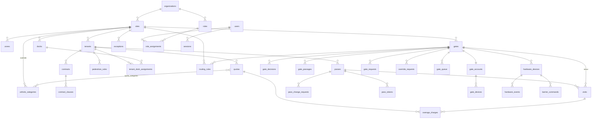

# Модель данных

Основа — `docs/spec/11_модель_данных.sql`, исправленная по `16_дополнения_и_уточнения.md` и решениям ADR. Схема — `packages/db/src/schema/*.ts` (Drizzle, файл на раздел §2), миграции — `packages/db/migrations/` (этап 2, ADR-014). Этот документ — источник истины: изменение схемы начинается здесь. Где реализация уточнила запись ниже — §7.

Соглашения:
- Ключи — `uuid` (`gen_random_uuid()`), журналы — `bigint identity`.
- Время — `timestamptz` (UTC). Локальные даты (сутки сверхлимита, отчёты) считаются в поясе объекта в момент записи и хранятся как `date` рядом.
- Все бизнес-таблицы несут `organization_id` (денормализован) — для фильтра и RLS. Таблицы объекта несут ещё `site_id`.
- Справочники удаляются мягко: `deleted_at`. Журналы (`visits`, `gate_decisions`, `audit_log`, `domain_events`, `hardware_events`, `barrier_commands`) не удаляются и не редактируются; у журналов есть `snapshot jsonb` с названиями на момент события.
- `created_at`/`updated_at` есть у всех редактируемых таблиц (опущены ниже для краткости). `updated_at` ставит триггер.
- Перечисления — `text` + `check` (не `enum`), чтобы менять без блокирующих миграций. Списки значений — в `packages/contracts` (zod), миграция и zod проверяются тестом на совпадение.
- Настройки с вложенной структурой (`sites.settings`, `exceptions.match`) — `jsonb`, валидируются zod-схемой из `packages/contracts` на записи.

## 1. Схема связей (ядро)



## 2. Таблицы

Формат: `колонка тип` — комментарий. `NN` = not null. FK подразумевает `references`.

### 2.1 Организация, объект, инфраструктура

```sql
organizations
  id uuid PK
  name text NN
  slug text NN unique                       -- для URL и логов без ПДн
  default_timezone text                     -- IANA; предзаполняет пояс нового объекта (ADR-009, дополнение); null — не задан
  settings jsonb NN default '{}'            -- OrganizationSettings (zod): срок хранения ПДн по умолчанию и т. п.
  deleted_at timestamptz

sites
  id uuid PK, organization_id uuid NN FK
  name text NN, address text, geo point
  timezone text NN                          -- IANA: 'Asia/Yekaterinburg'; проверяется Intl.supportedValuesOf('timeZone');
                                            -- меняется только отдельным действием с правом site.manage, причиной и аудитом (ADR-009)
  working_hours jsonb                       -- WorkingHours (zod): {"mon":[["08:00","20:00"]],...}; null = круглосуточно
  settings jsonb NN default '{}'            -- SiteSettings (zod), см. раздел 3
  deleted_at timestamptz

zones
  id uuid PK, organization_id, site_id NN FK
  name text NN
  kind text NN check in ('building','yard','parking','dock_area','office','other')
  deleted_at timestamptz

gates
  id uuid PK, organization_id, site_id NN FK
  name text NN                              -- «КПП-1»
  kind text NN check in ('perimeter','internal')   -- A4: внутренний пост не открывает визит
  admits text NN default 'vehicles_and_pedestrians' check in ('vehicles_and_pedestrians','vehicles','pedestrians')  -- «кого пропускает» (ADR-012)
  zone_id uuid FK zones                     -- для internal: в какую зону ведёт
  direction text NN default 'both' check in ('in','out','both')
  working_hours jsonb
  auto_pass_on_allow boolean NN default false   -- D: автопроезд для зелёных по камере
  settings jsonb NN default '{}'            -- GateSettings: звук, тема, таймаут запроса
  sort int NN default 100
  deleted_at timestamptz

docks
  id uuid PK, organization_id, site_id NN FK, zone_id uuid FK
  number text NN                            -- «19», «З1»
  kind text NN default 'leveller' check in ('leveller','ground_gate','other')
  counts_in_quota boolean NN default true   -- false: ворота не дают места в лимите «по докам»
  size text, deleted_at timestamptz
  unique (site_id, number)

parking_areas
  id uuid PK, organization_id, site_id NN FK, zone_id uuid FK
  name text NN, spaces int, deleted_at timestamptz
```

### 2.2 Справочники

```sql
vehicle_categories                          -- типы транспорта (ADR-012)
  id uuid PK, organization_id NN FK
  site_id uuid FK                           -- null = уровень организации; иначе переопределение на объекте
  preset_code text                          -- ключ из VEHICLE_CATEGORY_PRESETS ('car','light_truck','semi','truck_5t','special','bus','moto',…); null = свой тип
  name text NN                              -- переименовывается свободно: «грузовой свыше 5 т» (A1: порог — данные, не код)
  enabled boolean NN default true           -- выключенный тип не виден в формах, остаётся в истории
  dock_eligible boolean NN default false    -- «обычно едет к доку»: к нему применяется tenants.trucks_dock_required
  sort int NN                               -- порядок в списках, перетаскивание; дефолта при выборе нет
  deleted_at timestamptz
  unique (organization_id, coalesce(site_id, nil_uuid), preset_code) where preset_code is not null

visit_purposes
  id uuid PK, organization_id, site_id NN FK
  name text NN, max_stay_minutes int, sort int, deleted_at timestamptz

blacklist
  id uuid PK, organization_id NN FK, site_id uuid FK   -- null = вся организация
  plate_norm text, person_name text         -- хотя бы одно (check)
  reason text NN, valid_to timestamptz
  created_by uuid FK users, deleted_at timestamptz
  index (organization_id, plate_norm)
```

Форматы номеров по странам в MVP — код в `packages/plates` (таблица масок с тестами), не таблица БД. Если заказчику понадобится добавлять маски без релиза — вынесем в `plate_formats` (вопрос Q-14).

### 2.3 Арендаторы и договоры

```sql
tenants
  id uuid PK, organization_id, site_id NN FK
  legal_name text NN, short_name text NN, inn text
  is_operator boolean NN default false      -- A6: оператор как арендатор без лимитов
  status text NN default 'active' check in ('active','blocked_new_passes','blocked_entry','archived')
  trucks_dock_required boolean NN default false   -- A5
  default_category_id uuid FK vehicle_categories
  responsible_phone text, emergency_phone text
  color text, deleted_at timestamptz

contracts
  id uuid PK, organization_id, tenant_id NN FK
  number text, signed_on date, valid_from date, valid_to date
  status text NN default 'active' check in ('draft','active','expired','terminated')
  file_ref text                             -- ключ в хранилище файлов, не URL
  notes text, deleted_at timestamptz

contract_clauses
  id uuid PK, organization_id, contract_id NN FK
  ref text NN, summary text NN              -- «п. 2.1» · «30 легковых мест»

tenant_dock_assignments
  id uuid PK, organization_id, tenant_id NN FK, dock_id NN FK
  valid_from date NN, valid_to date, basis_clause_id uuid FK
  exclude using gist (dock_id with =, daterange(valid_from, valid_to, '[]') with &&)  -- док не бывает у двух арендаторов сразу

tenant_parking_assignments
  id uuid PK, organization_id, tenant_id NN FK, parking_area_id NN FK
  spaces int NN, valid_from date NN, valid_to date, basis_clause_id uuid FK

pedestrian_rules                            -- A3
  id uuid PK, organization_id, site_id, tenant_id NN FK
  zone_id uuid FK                           -- null = везде у арендатора
  document_required boolean NN default true
  escort text NN check in ('none','if_no_document','always')
  escort_phone text
  guard_text text                           -- одна строка для карточки поста
  deleted_at timestamptz

fleet_vehicles
  id uuid PK, organization_id, tenant_id NN FK
  plate_raw text NN, plate_norm text NN, plate_country text NN
  category_id uuid FK NN, brand text, driver_name text, driver_phone text
  deleted_at timestamptz
  unique (tenant_id, plate_norm) where deleted_at is null
```

### 2.4 Правила

```sql
quotas
  id uuid PK, organization_id, site_id, tenant_id NN FK
  participant text NN default 'vehicle' check in ('vehicle','pedestrian')
  name text NN                              -- подпись на табло: по умолчанию «Малотоннажный + фура + …», редактируется («Грузовые»)
  capacity int NN check >= 0                -- 0 = не предусмотрено договором
  capacity_from_docks boolean NN default false   -- capacity = число назначенных доков с counts_in_quota
  counting text NN default 'on_site' check in ('on_site','active_passes','per_day')
  enforcement text NN default 'hard' check in ('hard','soft','warn')
  overage_tariff_rub numeric(10,2), overage_cap int
  schedule jsonb                            -- действует только в часы; null = всегда
  basis_clause_id uuid FK
  valid_from timestamptz NN default now(), valid_to timestamptz
  deleted_at timestamptz
  -- отсутствие лимита у арендатора на тип = без ограничения (оператор); лимит 0 = запрет

quota_categories                            -- набор типов лимита (ADR-012); тип может входить в несколько лимитов — действуют все
  quota_id uuid FK NN, category_id uuid FK NN, PK (quota_id, category_id)
  -- для participant = 'pedestrian' строк нет

routing_rules
  id uuid PK, organization_id, site_id NN FK
  tenant_id uuid FK                         -- null = правило объекта; правило арендатора имеет приоритет
  participant text NN check in ('vehicle','pedestrian')
  category_id uuid FK                       -- null для пешехода или «любая»
  destination_zone_id uuid FK zones         -- для внутренних постов: «в АБК → КПП офис»
  gate_id uuid NN FK
  direction text NN default 'in' check in ('in','out','both')
  priority int NN default 100, deleted_at timestamptz

time_window_policies
  id uuid PK, organization_id, site_id NN FK
  tenant_id uuid FK                         -- null = все арендаторы
  window_required boolean NN default false
  early_tolerance_min int NN default 0
  late_tolerance_min int                    -- null = до конца пропуска
  on_violation text NN default 'hard' check in ('hard','warn')
  deleted_at timestamptz

time_window_policy_categories               -- к каким типам применяется; нет строк = ко всем
  policy_id uuid FK NN, category_id uuid FK NN, PK (policy_id, category_id)

exceptions
  id uuid PK, organization_id, site_id NN FK, tenant_id uuid FK
  name text NN
  match jsonb NN                            -- ExceptionMatch (zod): {plates:[...]} | {categoryIds:[...]} | {tenant:true} | {passIds:[...]}
  waives text[] NN                          -- подмножество ('inspection','quota','time_window','working_hours','routing')
  guard_text text                           -- «Служебный автобус — без досмотра»
  basis text, basis_clause_id uuid FK
  valid_from timestamptz NN default now(), valid_to timestamptz
  created_by uuid FK users, deleted_at timestamptz

approval_policies
  id uuid PK, organization_id, site_id NN FK
  tenant_id uuid FK                         -- null = по умолчанию для объекта
  creator_kind text NN check in ('tenant','gate','admin')
  pass_type text NN check in ('single','multi','permanent')
  mode text NN check in ('allow','on_request','deny')
  comment_required boolean NN default false
  escalation_hours int, on_timeout text check in ('reject','escalate')
  unique (site_id, coalesce(tenant_id, nil_uuid), creator_kind, pass_type)
```

### 2.5 Пропуска

```sql
passes
  id uuid PK, organization_id, site_id, tenant_id NN FK
  pass_type text NN check in ('single','multi','permanent')
  participant text NN check in ('vehicle','pedestrian')
  plate_raw text, plate_norm text, plate_country text
  category_id uuid FK, brand text
  person_name text, person_document text     -- пешеход; документ — только признак/тип, не номер
  driver_name text, driver_phone text
  purpose_id uuid FK
  destination_zone_id uuid FK zones, dock_id uuid FK docks   -- A4/A5; вместо destination jsonb
  valid_from timestamptz, valid_to timestamptz       -- null valid_to только для permanent
  window_from timestamptz, window_to timestamptz     -- окно прибытия
  status text NN check in ('draft','pending_approval','approved','rejected','cancelled','expired','used')
  comment text
  created_by uuid FK users, created_via text NN check in ('web','pwa','bot','api','gate','import')
  created_by_gate_account_id uuid FK        -- если создан с поста
  batch_id uuid FK pass_batches
  approved_by uuid, approved_at timestamptz, approval_note text, approval_changes jsonb
  approval_escalated_at timestamptz          -- согласование эскалировано по сроку политики (on_timeout = escalate)
  cancelled_reason text, closed_at timestamptz
  source_ref text                            -- id в PASS24 при импорте
  index gin (plate_norm gin_trgm_ops), index gin (person_name gin_trgm_ops)
  index (site_id, status), index (tenant_id, status)
  exclude using gist (tenant_id with =, plate_norm with =, tstzrange(valid_from, coalesce(valid_to, 'infinity')) with &&)
    where (status = 'approved' and plate_norm is not null)   -- дубли у одного арендатора запрещены (10_, §4); permanent — до бесконечности

pass_batches
  id uuid PK, organization_id, site_id, tenant_id NN FK
  created_by uuid NN, total int NN, created int NN, errors jsonb NN   -- [{row, field, code, message}]

pass_change_requests                        -- A8
  id uuid PK, organization_id, pass_id NN FK
  changes jsonb NN                          -- {"plate_raw":{"from":..,"to":..}}
  reason text, status text NN check in ('pending','approved','rejected','cancelled')
  requested_by uuid NN, decided_by uuid, decided_at timestamptz, decision_note text

pass_tokens                                 -- страница водителя
  id uuid PK, organization_id, pass_id NN FK
  token_hash text NN unique, expires_at timestamptz NN, revoked_at timestamptz
  consent_at timestamptz                    -- 152-ФЗ: водитель подтвердил согласие
  last_opened_at timestamptz
```

### 2.6 Визиты и журнал КПП

```sql
visits
  id uuid PK, organization_id, site_id, tenant_id NN FK
  pass_id uuid FK                           -- null: выезд без пропуска
  participant text NN, category_id uuid FK, plate_norm text
  snapshot jsonb NN                         -- {"tenant":"ДНС","category":"фура","plate":"H524MC136","gateIn":"КПП-2","dock":"12"}
  gate_in_id uuid FK, time_in timestamptz, gate_account_in_id uuid FK, device_in_id uuid FK
  gate_out_id uuid FK, time_out timestamptz, gate_account_out_id uuid FK, device_out_id uuid FK
  method_in text check in ('button','qr','lpr','auto','sync'), method_out text (same)
  hardware_event_in_id bigint FK, hardware_event_out_id bigint FK
  decision_in_id bigint FK gate_decisions, decision_out_id bigint FK
  overage boolean NN default false, overage_quota_id uuid FK
  exception_id uuid FK, override_id uuid FK override_requests   -- exception_id — только исключение, снявшее лимит: такой визит место не занимает
  flags text[] NN default '{}'              -- 'no_checkin','after_expiry','over_stay','offline_over_quota','undone','pass_cancelled_meanwhile'
  client_time_in timestamptz, client_time_out timestamptz   -- время устройства при офлайн-отметке
  index (site_id, tenant_id, category_id) where time_out is null    -- подсчёт лимитов
  index (site_id, plate_norm) where time_out is null
  index (pass_id)

gate_decisions                              -- каждый вердикт, включая отказы и «не тот КПП»
  id bigint identity PK, organization_id, site_id, gate_id NN FK
  at timestamptz NN default now(), client_at timestamptz
  direction text NN check in ('in','out')
  pass_id uuid FK, plate_query text, hardware_event_id bigint FK
  verdict text NN check in ('allow','allow_overage','wait','wrong_gate','deny','no_pass')
  reasons jsonb NN, trace jsonb NN, engine_version text NN
  action text check in ('check_in','check_out','refuse','redirect','request','override_request','none','undo','passage')
  visit_id uuid FK, override_id uuid FK
  gate_account_id uuid FK, device_id uuid FK, user_id uuid FK   -- user_id: админ в песочнице/при переопределении
  offline boolean NN default false
  snapshot jsonb NN
  index (site_id, at desc), index (pass_id)

gate_passages                               -- A4: внутренние посты
  id bigint identity PK, organization_id, site_id, gate_id NN FK
  at timestamptz NN, pass_id uuid FK, direction text
  decision_id bigint FK, gate_account_id uuid FK, device_id uuid FK, snapshot jsonb NN

gate_actions                                -- действия поста с идемпотентным id (ADR-005, ADR-017); только insert
  id uuid PK                                -- id, присланный устройством: повтор с тем же id не выполняет действие второй раз
  organization_id, site_id, gate_id NN FK
  type text NN check in ('check_in','check_out','refuse','redirect','undo','passage')
  gate_account_id uuid FK, device_id uuid FK, user_id uuid FK
  client_at timestamptz, received_at timestamptz NN
  offline boolean NN default false          -- пришло из офлайн-очереди (POST /gate/actions/sync)
  request_hash text NN                      -- отпечаток тела: тот же id с другими данными — ошибка idempotency_conflict
  outcome text NN check in ('applied','merged','rejected')
  pass_id uuid FK, visit_id uuid FK, decision_id bigint FK gate_decisions
  undo_of uuid FK gate_actions               -- для undo: какое действие отменено
  response jsonb NN                         -- ответ клиенту; повтор получает его же
  unique (undo_of) where undo_of is not null -- действие отменяется не больше одного раза

gate_queue                                  -- B5: очередь у ворот
  id uuid PK, organization_id, site_id, tenant_id NN FK, gate_id NN FK
  pass_id uuid NN FK, quota_id uuid NN FK
  queued_at timestamptz NN, notified_at timestamptz, left_at timestamptz
  left_reason text check in ('entered','cancelled','timeout','redirected')
  unique (pass_id) where left_at is null

gate_requests                               -- машина/пешеход без пропуска
  id uuid PK, organization_id, site_id, gate_id NN FK, tenant_id uuid FK
  participant text NN, plate_raw text, plate_norm text, category_id uuid FK, person_name text
  status text NN check in ('open','approved','rejected','timeout','cancelled')
  created_by_gate_account_id uuid FK, device_id uuid FK
  answered_by uuid FK users, answered_at timestamptz, answer_note text
  pass_id uuid FK                           -- созданный пропуск
  expires_at timestamptz NN

override_requests                           -- A11: запрос исключения с поста
  id uuid PK, organization_id, site_id, gate_id NN FK
  pass_id uuid FK, plate_norm text, direction text NN
  verdict_code text NN, reasons jsonb NN    -- что было на карточке
  reason text NN                            -- причина от поста
  status text NN check in ('pending','approved','rejected','expired','used')
  requested_by_gate_account_id uuid NN FK, device_id uuid FK
  decided_by uuid FK users, decided_at timestamptz, decision_note text
  via text check in ('admin','senior_pin')  -- одобрил админ или PIN старшего на посту
  valid_until timestamptz                   -- одобрение действует N минут
```

### 2.7 Деньги и нарушения

```sql
overage_charges
  id uuid PK, organization_id, site_id, tenant_id, quota_id NN FK, visit_id NN FK
  day date NN                               -- местные сутки объекта
  tariff_rub numeric(10,2) NN
  unique (visit_id, day)
  -- начисляет фоновая задача на каждом локальном полуночи и при выезде; пересчёт идемпотентен

violations                                  -- v2, таблица создаётся сразу
  id uuid PK, organization_id, site_id, tenant_id uuid FK, visit_id uuid FK
  kind text NN, rule_ref text, fine_rub numeric(10,2), photos text[]
  status text NN default 'draft' check in ('draft','signed','disputed','cancelled')
  created_by uuid, created_at timestamptz
```

### 2.8 Люди, роли, учётки КПП

```sql
users                                       -- платформенные: один человек может состоять в нескольких организациях/арендаторах
  id uuid PK
  full_name text NN, email citext unique, phone text unique   -- хотя бы одно
  password_hash text                        -- argon2id; null, пока приглашение не принято
  status text NN default 'invited' check in ('invited','active','disabled')
  locale text NN default 'ru', last_login_at timestamptz
  must_change_password boolean NN default false
  show_own_time boolean NN default false    -- «показывать ещё и моё время» второй строкой (ADR-009, дополнение)
  own_timezone text                         -- IANA, выбирает пользователь; check: show_own_time → own_timezone not null
  consent_at timestamptz                    -- согласие на обработку ПДн при принятии приглашения (152-ФЗ)

roles
  id uuid PK, organization_id NN FK
  name text NN, permissions text[] NN default '{}'   -- коды из packages/contracts/permissions.ts
  is_template boolean NN default false, deleted_at timestamptz
  template_code text                        -- код шаблона (contracts ROLE_TEMPLATES): «Пост КПП» для новой учётки КПП; unique (organization_id, template_code)

role_assignments
  id uuid PK, organization_id NN FK, user_id NN FK, role_id NN FK
  site_id uuid FK                           -- null = вся организация
  tenant_id uuid FK                         -- для пользователей арендатора
  unique (user_id, role_id, coalesce(site_id, nil), coalesce(tenant_id, nil))

invitations
  id uuid PK, organization_id NN FK
  email citext, phone text, full_name text
  role_id uuid NN FK, site_id uuid FK, tenant_id uuid FK
  token_hash text NN unique, expires_at timestamptz NN
  invited_by uuid NN, accepted_at timestamptz, accepted_user_id uuid FK
  revoked_at timestamptz                    -- отозвано администратором или заменено повторной отправкой

sessions                                    -- cookie-сессии пользователей (opaque id)
  id uuid PK, user_id NN FK
  token_hash text NN unique, created_at, last_seen_at, expires_at timestamptz NN
  ip inet, user_agent text, revoked_at timestamptz
  organization_id uuid FK                   -- текущая организация сессии (у пользователя их может быть несколько)

password_resets                             -- одноразовые ссылки установки пароля: восстановление, сброс администратором, владелец при чистом старте
  id uuid PK, user_id NN FK
  purpose text NN check in ('setup','reset')
  token_hash text NN unique, expires_at timestamptz NN, used_at timestamptz
  created_by uuid FK users                  -- администратор, выдавший ссылку; null — сам пользователь или чистый старт
  created_at

auth_events                                 -- журнал входа платформы (без RLS): вход, неудачи, выход, коды, ссылки; источник ограничения попыток
  id bigint identity PK, at timestamptz NN default now()
  kind text NN                              -- 'login','login_failed','logout','logout_all','password_set','password_reset_requested',…
  user_id uuid FK, login_hash text          -- SHA-256 нормализованного логина: сам логин (e-mail/телефон) не хранится
  ip inet, user_agent text, request_id text
  index (login_hash, at), index (ip, at); только insert

login_codes                                 -- вход по коду из SMS/e-mail
  id uuid PK, user_id NN FK, code_hash text NN, expires_at timestamptz NN, attempts int NN default 0, used_at timestamptz

gate_accounts                               -- A11: одна учётка на КПП
  id uuid PK, organization_id, site_id, gate_id NN FK unique
  role_id uuid NN FK                        -- шаблон «Пост КПП»
  status text NN default 'active' check in ('active','disabled')

gate_devices
  id uuid PK, organization_id, gate_account_id NN FK
  name text NN                              -- «ПК КПП-2», «планшет»
  kind text NN default 'post' check in ('post','agent')   -- agent = агент КПП (раздел D)
  token_hash text NN unique                 -- долгоживущий; показывается один раз
  enrolled_by uuid FK users, enrolled_at timestamptz NN
  last_seen_at timestamptz, last_ip inet, app_version text
  revoked_at timestamptz, revoked_by uuid, revoke_reason text

device_enrollments                          -- одноразовый код/QR для привязки
  id uuid PK, organization_id, gate_account_id NN FK, kind text NN
  code_hash text NN unique, expires_at timestamptz NN, used_at timestamptz, used_device_id uuid FK
  created_by uuid FK users                  -- кто выдал код в админке

shift_marks                                 -- необязательная «отметка смены» (настройка объекта)
  id uuid PK, organization_id, gate_account_id NN FK, device_id uuid FK
  guard_name text NN, started_at timestamptz NN, ended_at timestamptz

push_subscriptions
  id uuid PK, user_id NN FK, endpoint text NN unique, keys jsonb NN, created_at, failed_at timestamptz

notification_preferences
  user_id NN FK, tenant_id uuid FK, kind text NN, channel text NN check in ('email','push','telegram'), enabled boolean NN
  PK (user_id, coalesce(tenant_id, nil), kind, channel)

telegram_links
  user_id uuid PK FK, chat_id bigint NN unique, linked_at timestamptz
```

### 2.9 Оборудование (раздел D)

```sql
hardware_devices
  id uuid PK, organization_id, site_id, gate_id NN FK
  kind text NN check in ('lpr_camera','barrier','qr_scanner','acs_controller','post_pc')
  name text NN, adapter text NN             -- 'sim-camera','sim-barrier','hikvision-isapi'…
  direction text check in ('in','out','both')
  config jsonb NN default '{}'              -- параметры адаптера (без секретов; секреты — у агента)
  agent_device_id uuid FK gate_devices      -- через какой агент подключено
  status text NN default 'unknown' check in ('online','offline','unknown')
  last_seen_at timestamptz, deleted_at timestamptz

hardware_events                             -- входящие события
  id bigint identity PK, organization_id, site_id, gate_id NN FK, device_id uuid FK
  type text NN check in ('plate_recognized','qr_scanned','barrier_state','heartbeat','acs_pass')
  direction text, at timestamptz NN, received_at timestamptz NN default now()
  plate_raw text, plate_norm text, confidence real
  payload jsonb NN default '{}', photo_ref text, photo_expires_at timestamptz
  agent_seq bigint                          -- порядковый номер у агента; (device_id, agent_seq) unique → идемпотентность
  matched_pass_id uuid FK, decision_id bigint FK
  index (site_id, at desc)

barrier_commands                            -- исходящие команды
  id uuid PK, organization_id, site_id, gate_id NN FK, device_id NN FK
  type text NN check in ('open','close','test')
  direction text, issued_at timestamptz NN default now()
  issued_by_user_id uuid FK, issued_by_gate_account_id uuid FK, device_issued_from uuid FK gate_devices
  cause text NN check in ('check_in','check_out','override','manual_test','auto_pass')
  visit_id uuid FK, decision_id bigint FK
  status text NN default 'queued' check in ('queued','sent','done','failed','timeout')
  sent_at, finished_at timestamptz, result jsonb
  index (device_id, status) where status in ('queued','sent')
```

### 2.10 Аудит, события, уведомления

```sql
audit_log                                   -- только insert; роль приложения без update/delete
  id bigint identity PK, organization_id NN, site_id uuid
  at timestamptz NN default now()
  actor_type text NN check in ('user','gate_account','system','agent')
  actor_user_id uuid, actor_gate_account_id uuid, device_id uuid
  request_id text, ip inet
  entity text NN, entity_id uuid NN
  action text NN                            -- 'create','update','delete','approve','reject','override','login',…
  diff jsonb                                -- {"category_id":{"from":..,"to":..,"fromLabel":"фура","toLabel":"легковой"}}
  reason text, snapshot jsonb
  index (organization_id, at desc), index (entity, entity_id)

domain_events                               -- transactional outbox (ADR-004)
  id bigint identity PK, organization_id NN, site_id uuid
  at timestamptz NN default now()
  type text NN                              -- 'visit.opened','visit.closed','pass.created','pass.updated','quota.changed',
                                            -- 'gate_request.created','gate_request.answered','override.decided','queue.slot_freed',…
  aggregate text NN, aggregate_id uuid NN
  payload jsonb NN                          -- без ПДн сверх необходимого для экрана
  index (site_id, id)                       -- SSE replay по Last-Event-ID

notifications
  id uuid PK, organization_id NN, user_id NN FK
  kind text NN, channel text NN, payload jsonb NN
  status text NN check in ('queued','sent','failed','skipped'), sent_at timestamptz, error text
  event_id bigint FK domain_events
```

Фоновые задачи — таблицы схемы `pgboss` (создаёт pg-boss сам).

## 3. `sites.settings` (zod `SiteSettings`)

| Ключ | Тип | По умолчанию | Смысл |
|---|---|---|---|
| `singlePassMaxHours` | int | 24 | Срок разового |
| `multiPassMinDays` / `multiPassMaxDays` | int | 2 / 31 | Срок многоразового |
| `singleReturnWindowMin` | int \| null | null | «Возврат в течение X минут» для разового (вопрос Q-7) |
| `outsideWorkingHours` | `'deny'\|'warn'\|'allow'` | `warn` | Въезд вне рабочего времени |
| `gateRequestTimeoutMin` | int | 10 | Сколько ждёт запрос «без пропуска» |
| `overrideValidMin` | int | 15 | Срок одобренного исключения |
| `undoWindowSec` | int | 120 | Отмена последнего действия |
| `pastStartToleranceMin` | int | 10 | Допуск на «начало пропуска в прошлом» при создании и изменении начала (Q-58) |
| `shiftMarkEnabled` | bool | false | Отметка смены (A11) |
| `seniorPinHash` | string \| null | null | PIN старшего смены (A11) |
| `dutyAdminPhone` | string | — | Телефон внизу экрана поста |
| `retentionDays.visits` / `.photos` / `.audit` | int | 1095 / 30 / 1095 | Хранение (152-ФЗ) |
| `plateFuzzyThreshold` | number | 0.85 | Порог уверенности камеры |
| `permanentPassReviewMonths` | int | 6 | Напоминание о ревизии постоянных |

## 4. Мультиарендность и RLS

- Каждая таблица с данными организации имеет `organization_id`. Приложение в начале транзакции выполняет `set local app.organization_id = '<uuid>'` (и `app.site_id`, где уместно) — хелпер `withOrganization(db, orgId, fn)` из `@oxrana/db`.
- На всех таких таблицах включён RLS с политикой `organization_id = nullif(current_setting('app.organization_id', true), '')::uuid` (`USING` и `WITH CHECK`); таблицы-связки без `organization_id` — через видимость родителя; платформенные таблицы (`users`, `sessions`, `login_codes`, `password_resets`, `auth_events`, `push_subscriptions`, `notification_preferences`, `telegram_links`) — без RLS (ADR-014 п. 4). Приложение ходит под ролью `oxrana_app` без `BYPASSRLS`; миграции и сид — под владельцем `oxrana_owner`.
- Запросы фильтруют по `organization_id` явно (Drizzle-хелпер `scoped(table, ctx)`), RLS — вторая линия. Тест: запрос с чужим `organization_id` возвращает пусто.
- Пользователи арендатора видят только `tenant_id` из своих `role_assignments` — это проверяется в сервисном слое (RLS по арендатору не делаем: у охраны и админа срез по объекту).

## 5. Что изменено относительно `11_модель_данных.sql` и почему

| # | Изменение | Почему |
|---|---|---|
| 1 | Убраны `users.pin_hash`, `shifts`, `role_assignments.scope_gate_id`; добавлены `gate_accounts`, `gate_devices` (с привязкой к учётке, не к КПП напрямую), `device_enrollments`, необязательные `shift_marks` | `16_` A11: одна учётка на КПП, без личных PIN |
| 2 | `gates.kind` (`perimeter`/`internal`), `gates.zone_id`, таблица `gate_passages` | A4: КПП офис — внутренний пост, проход не открывает визит |
| 3 | `passes.destination jsonb` → `destination_zone_id` + `dock_id` (FK); `tenants.trucks_dock_required`; `docks.counts_in_quota` | A5: док обязателен и выбирается из списка; ворота, не дающие места в лимите, отмечаются `counts_in_quota = false`; маршрут пешехода по месту назначения |
| 4 | `tenants.is_operator` | A6: оператор — арендатор без лимитов |
| 5 | Таблица `pedestrian_rules` | A3: правила пешеходов на арендатора (× зона) |
| 6 | Таблица `pass_change_requests` | A8: заявка на изменение начавшегося согласованного пропуска |
| 7 | Таблица `override_requests`; из `gate_decisions` убран `override_reason`, добавлены `override_id`, `trace`, `engine_version`, `direction`, `offline`, `client_at`, `hardware_event_id` | A11 (запрос исключения администратору), B2 (объяснимость), офлайн и камеры |
| 8 | Таблицы `hardware_devices`, `hardware_events`, `barrier_commands`; `gate_devices.kind = 'agent'`; `gates.auto_pass_on_allow`; `visits.method` расширен (`auto`, `sync`), `visits.hardware_event_*`, `photo_ref` в событиях | Раздел D: контракты и таблицы сейчас, драйверы позже |
| 9 | Таблица `gate_queue` | B5: очередь у ворот FIFO, сигнал только первой |
| 10 | Таблица `domain_events` (outbox) | ADR-004: realtime, уведомления и вебхуки из одного источника, в одной транзакции с изменением |
| 11 | `users` — платформенные (без `organization_id`), `role_assignments.organization_id`; `invitations`, `sessions`, `login_codes` | Один человек в нескольких арендаторах/организациях (04_); приглашения со сроком (D2); отзываемые сессии |
| 12 | `organization_id` на всех бизнес-таблицах + RLS | CLAUDE.md п. 9: фильтр по организации на сервере; защита от ошибки в запросе |
| 13 | `quotas.site_id`, `quotas.name`, `quotas.deleted_at`; `vehicle_categories.deleted_at`; `deleted_at` у всех справочников | Мягкое удаление везде (CLAUDE.md п. 10) |
| 14 | `visits.plate_norm`, `participant`, `decision_in/out_id`, `gate_account_*`, `device_*`, флаги `offline_over_quota`, `undone`, `client_time_*` | Поиск открытого визита по номеру без пропуска; связь с вердиктом; офлайн-синхронизация (ADR-005) |
| 15 | Exclusion-constraint на дубли активных пропусков и на назначения доков | `10_` §4 и §1: невозможные состояния запрещает БД, а не только форма |
| 16 | `pass_batches`, `pass_tokens` (с `consent_at`), `fleet_vehicles` | B3 «создано N из N»; страница водителя с токеном и согласием (D7, B11); автопарк из `04_` отсутствовал в `11_` |
| 17 | `approval_policies.tenant_id`, `escalation_hours`, `on_timeout` | `10_` §6: эскалация; доверенный арендатор |
| 18 | `exceptions.match` типизирован zod; `guard_text`; `basis_clause_id` | Строка для карточки поста; основание — пункт договора |
| 19 | `routing_rules.destination_zone_id`, `deleted_at` | Маршрут пешехода по месту назначения (A4) |
| 20 | `contracts.status`, `file_ref` вместо `file_url` | Файлы в хранилище по ключу, ссылки подписываются при выдаче |
| 21 | `blacklist.created_by`, `deleted_at`; `audit_log.actor_type`, `request_id`, `snapshot` | Аудит «кто и откуда» для учётки КПП и системы |
| 22 | `overage_charges.tenant_id/site_id`; `notifications`, `push_subscriptions`, `notification_preferences`, `telegram_links` | Отчёт сверхлимитов без join-цепочки; уведомления из `05_` §5 |
| 23 | `users.email citext`; `must_change_password` | Вход без учёта регистра; пароль, выданный админом, меняется при первом входе (§26 справки) |
| 24 | Перечисления — `text + check`, а не Postgres `enum` | Добавление значения без `ALTER TYPE` и блокировок |
| 25 | Убраны `category_groups` и `category_group_members`; лимит связан с типами напрямую через `quota_categories`; `quotas.name` обязателен | ADR-012: пользователь не создаёт «групп», лимит = «типы — число»; тип в нескольких лимитах — действуют все |
| 26 | `vehicle_categories`: `preset_code` вместо `code`, `enabled`, `dock_eligible`, `sort` без дефолта 100 | ADR-012: рекомендованный набор включается кликом, свои типы и переименование, порядок перетаскиванием |
| 27 | `gates.admits` (машины и пешеходы / только машины / только пешеходы) | ADR-012: карточка КПП; пешеход на КПП «только машины» → `wrong_gate` без правил маршрута |
| 28 | `time_window_policy_categories` вместо `category_group_id` | следствие п. 25 |

## 6. Хранение ПДн (152-ФЗ) — где лежат персональные данные

| Данные | Таблицы | Срок | Примечание |
|---|---|---|---|
| ФИО, телефон, e-mail пользователей | `users`, `invitations` | пока учётка активна + 1 год | не пишутся в `pino`-логи (редакция по ключам) |
| ФИО водителя/пешехода, телефон, номер | `passes`, `visits.snapshot`, `gate_requests`, `fleet_vehicles` | `retentionDays.visits` | задача `retention` обезличивает (`person_name → null`, `plate_norm → хэш`) по сроку |
| Фото с камер | хранилище файлов, ссылка в `hardware_events.photo_ref` | `retentionDays.photos` | удаляются задачей |
| «Было → стало» правок пропусков (номер, ФИО) | `audit_log.diff`, `pass_change_requests.changes`, `pass_batches.errors` | `retentionDays.audit` | журнал в БД; в технические логи и `domain_events.payload` не попадают |
| Согласия | `pass_tokens.consent_at`, `users` (при приёме приглашения) | вместе с записью | |

## 7. Уточнения реализации (этап 2)

Схема реализована строго по §2 (54 таблицы). Ниже — места, где запись §2 уточнена при реализации, и почему. Решения — ADR-014.

| # | Где | Как в §2 | Как в БД | Почему |
|---|---|---|---|---|
| 1 | `approval_policies`, `role_assignments`, `notification_preferences` | `unique (…, coalesce(x, nil), …)` | `UNIQUE NULLS NOT DISTINCT (…, x, …)` | то же поведение (null — одно значение) встроенным средством PostgreSQL 15+, без выражений; у `vehicle_categories` (частичный индекс) оставлен `coalesce` |
| 2 | `notification_preferences` | `PK (user_id, coalesce(tenant_id, nil), kind, channel)` | без PK, уникальность — п. 1 | в первичный ключ нельзя включить выражение и nullable-колонку |
| 3 | `vehicle_categories.preset_code`, `visits.participant`, `gate_requests.participant`, `gate_passages.direction`, `override_requests.direction`, `override_requests.verdict_code`, `device_enrollments.kind` | перечисление без `check` | `check` по спискам contracts (`VEHICLE_CATEGORY_PRESET_CODES`, `PARTICIPANTS`, `PASSAGE_DIRECTIONS`, `VERDICT_CODES`, `GATE_DEVICE_KINDS`) | соглашение «перечисления — `text` + `check`»; `device_enrollments.kind` трактуется как вид привязываемого устройства (`post`/`agent`). Свободным текстом остались открытые списки: `notifications.kind/channel`, `violations.kind`, `audit_log.action`, `domain_events.type`, `hardware_events.direction`, `barrier_commands.direction` — их значения появятся на этапах 10 и 14 |
| 4 | `quota_categories`, `time_window_policy_categories` | без `organization_id` | без `organization_id`, RLS через родителя (`exists` по `quotas` / `time_window_policies`) | изоляция без денормализации (ADR-014 п. 4) |
| 5 | `organization_id` в журналах (`audit_log`, `domain_events`, `notifications`) | `NN` | `NN` + FK на `organizations` | как у остальных бизнес-таблиц |
| 6 | `created_at`/`updated_at` | «у всех редактируемых таблиц» | `created_at` + `updated_at` (триггер) — у 31 справочника и бизнес-таблицы; только `created_at` — у `pass_batches`, `pass_tokens`, `role_assignments`, `invitations`, `login_codes`, `device_enrollments`, `overage_charges`, `notifications`; журналы — со своим временем события (`at`, `time_in`, `queued_at`, `issued_at`) | журналы не редактируются; токены и связи создаются и удаляются, но не правятся. У `violations` добавлен `updated_at` (меняется статус) |
| 7 | права `oxrana_app` | ADR-003: без `UPDATE`/`DELETE` на 4 журнала | то же + без `DELETE` на `visits` и `barrier_commands` | журналы не удаляются (§ соглашения); эти два обновляются выездом и статусом команды |
| 8 | NOTIFY outbox | ADR-004: `{"siteId", "id"}` | `{"id", "organizationId", "siteId"}` | слушатель читает событие под RLS |
| 9 | `sites.settings` | `SiteSettings` | хранятся только заданные ключи, значения по умолчанию — в zod (`SiteSettingsSchema.parse`) | новая настройка с дефолтом не требует миграции данных |
| 10 | `sites.working_hours`, `gates.working_hours`, `quotas.schedule` | `{"mon":[["08:00","20:00"]],…}` | то же, все семь дней явно (`WorkingHours`), `[]` — выходной | нет двусмысленности «день не указан = выходной или круглосуточно» |

## 8. Уточнения реализации (этап 4)

Решения — ADR-017; пояса — ADR-009 (дополнение). Миграции `0003_gate_actions_timezones.sql` (сгенерирована) и `0004_gate_actions_grants.sql` (вручную).

| # | Где | Что | Почему |
|---|---|---|---|
| 1 | `gate_actions` (новая, 55-я таблица) | действие поста с id устройства, итог, сохранённый ответ, отпечаток тела; только insert (`REVOKE UPDATE, DELETE` в 0004); `undo_of` уникален | идемпотентность действий онлайн и из офлайн-очереди (ADR-005): повтор возвращает тот же ответ |
| 2 | `organizations.default_timezone` | IANA, может быть `null` | пояс по умолчанию для нового объекта (ADR-009) |
| 3 | `users.show_own_time`, `users.own_timezone` | `check (not show_own_time or own_timezone is not null)` | «показывать ещё и моё время» второй строкой (ADR-009) |
| 4 | `gate_decisions.action` | + `passage` | проход внутреннего поста пишется в журнал КПП как решение |
| 5 | `visits.flags` | + `pass_cancelled_meanwhile` | офлайн-въезд по пропуску, отменённому за это время (ADR-005) |
| 6 | `visits.exception_id` | только исключение, **снявшее лимит** | такой визит не занимает место; остальные применённые исключения видны в `gate_decisions.trace` |
| 7 | `visits` | вставка — только `packages/db/src/queries/visits.ts` (`insertVisit`), вызывается транзакцией въезда | ADR-006: все пути создания визита — через `checkIn()`; проверяет архитектурный тест |
| 8 | `pass_tokens` | создаётся вместе с пропуском, срок — конец пропуска + сутки (постоянный — год) | ссылка на страницу водителя в ответе создания (ARCHITECTURE §3.2) |
| 9 | `pass_batches` | строка пакета создаётся до строк пропусков (на неё ссылается `passes.batch_id`), итог дописывается в конце | «создано N из M» с ошибками по строкам; предпросмотр строку не создаёт |
| 10 | `gate_queue` | `quota_id` — самый тесный жёсткий лимит, из-за которого «ждать»; `notified_at` — кому уже отправлен сигнал «место освободилось» | сигнал только первым по числу свободных мест (сценарий 40) |

## 9. Уточнения реализации (этап 5)

Решения — ADR-018. Миграции `0005_auth.sql` (сгенерирована) и `0006_auth_functions.sql` (вручную).

| # | Где | Что | Почему |
|---|---|---|---|
| 1 | `roles.template_code` | код шаблона роли, уникален в организации; заполняется сидом, чистым стартом и миграцией (по названию шаблона) | новая учётка КПП получает роль «Пост КПП» организации — её надо найти не по названию (название редактируется) |
| 2 | `sessions.organization_id` | текущая организация сессии | `Actor` — одна организация; человек с назначениями в нескольких организациях переключает её |
| 3 | `password_resets` (новая) | одноразовая ссылка установки пароля: `setup` (владелец при чистом старте) и `reset` (восстановление, сброс администратором); в БД — SHA-256 токена | пароль владельца не проходит через логи и командную строку |
| 4 | `auth_events` (новая, платформенная, только insert) | вход, неудачные попытки, выход, запросы кодов и ссылок; логин — только хэшем | ограничение попыток по логину и по IP без Redis; журнал входа для неизвестного логина (у него нет организации для `audit_log`) |
| 5 | `invitations.revoked_at`, `device_enrollments.created_by`, `users.consent_at` | отзыв и повторная отправка приглашения; кто выдал код привязки; согласие на ПДн при принятии приглашения | аудит и 152-ФЗ (§6) |
| 6 | `passes.approval_escalated_at` | время эскалации согласования | эскалация по `approval_policies.escalation_hours` выполняется один раз |
| 7 | функции `auth_org_of_token(kind, hash)`, `auth_user_organizations(user_id)`, `app_organization_ids()` | `SECURITY DEFINER`, владелец `oxrana_owner`, `EXECUTE` — только `oxrana_app`; возвращают **только id организации** | токен устройства, код привязки и ссылка приглашения приходят без организации, а таблицы под RLS; дальше запрос идёт обычным путём в контексте найденной организации |

## 10. Уточнения реализации (этап 6b)

Решения — ADR-021. Миграция `0007_admin_rules.sql` (сгенерирована; права и RLS новой таблицы — в ней же).

| # | Где | Что | Почему |
|---|---|---|---|
| 1 | `tenants.status` | + `blocked_full` (полная блокировка: нельзя ни оформлять пропуска, ни въезжать; выезд разрешён всегда). `blocked_new_passes` — только новые пропуска; `blocked_entry` — только въезд (новые пропуска оформлять можно) | три режима блокировки арендатора с последствиями (Q-73) |
| 2 | `tenants.status_reason`, `tenants.status_changed_at` | причина и время последней смены статуса | карточка арендатора показывает, почему он заблокирован; подробности — в `audit_log` |
| 3 | `stored_files` (новая, 58-я таблица) | `id`, `organization_id`, `kind` (`contract`), `file_name`, `content_type`, `size_bytes`, `sha256`, `created_by`, `created_at`, `deleted_at`; сам файл — в `FileStore` по ключу `<organization_id>/<id>` | файл договора необязателен, лежит на локальном томе (Q-63, ADR-021); `contracts.file_ref` = `stored_files.id` |
| 4 | `vehicle_categories_preset_key` | частичный индекс: `where preset_code is not null and deleted_at is null` | повторное включение мягко удалённого типа из набора (Q-68) |
| 5 | `pedestrian_rules_tenant_zone_key` (новый) | `unique (tenant_id, coalesce(zone_id, nil)) where deleted_at is null` | одно правило на «арендатор × зона» и одно «везде у арендатора»; движок берёт первое найденное, дубль был бы молчаливой неоднозначностью (Q-66) |
| 6 | `organizations.settings` | ключ `trackContracts` (bool, по умолчанию `true`) — `OrganizationSettings` | «Вести договоры»: выключено — разделы и поля договоров скрыты (договоры могут быть коммерческой тайной) |
| 7 | `blacklist` | без изменений схемы; запись «объект» (`site_id`) или «организация» (`site_id is null`); срок `valid_to` (`null` — бессрочно); `created_by` | ADR-017: API и экраны — этап 6b |
