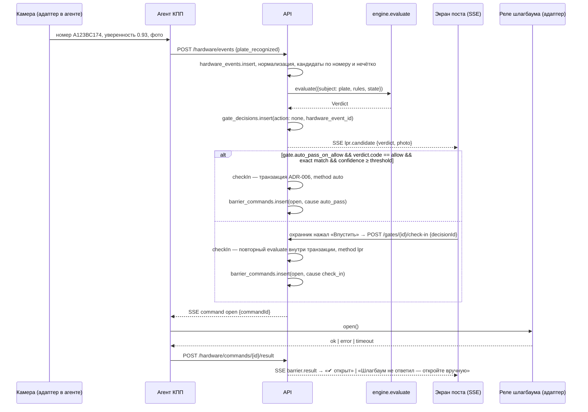

# Движок вердикта — контракт `@oxrana/engine`

Пакет `packages/engine`. Чистые функции: без БД, сети, системных часов, `Math.random`, `Date.now()` — это проверяет `scripts/check-engine-purity.ts` (ADR-015). Время и все данные приходят параметрами. Один и тот же собранный код выполняется в API-сервере, в PWA поста (офлайн), в песочнице админки и в тестах. Единственная зависимость — `@oxrana/plates` (похожие номера, §6); из платформы — только `Intl` для локальных суток и форматирования времени в причинах.

> Реализовано на этапе 3. Уточнения, внесённые при реализации, помечены «(ADR-015)».

## 1. Вход

```ts
type Instant = number;                 // мс с эпохи (UTC). Date не используем, чтобы не тащить пояс среды

interface EvaluationInput {
  now: Instant;
  site: { id; timezone: string; workingHours: WorkingHours | null; settings: SiteSettings };
  gate: { id; name; kind: 'perimeter' | 'internal'; admits: 'vehicles_and_pedestrians'|'vehicles'|'pedestrians'; zoneId?: string; direction: 'in'|'out'|'both' };
  direction: 'in' | 'out';
  subject: Subject;                    // что проверяем — см. ниже
  rules: RuleSet;                      // срез правил объекта (один и тот же на сервере и в кэше поста)
  state: LiveState;                    // занятость лимитов и открытые визиты — то, что меняется каждую минуту
  overrides: ApprovedOverride[];       // одобренные запросы исключений для этого субъекта/КПП
}

type Subject =
  | { kind: 'pass'; pass: PassView; tenant: TenantView; category?: CategoryView; openVisit?: VisitView }
  | { kind: 'plate'; plateNorm: string; candidates: PassView[]; openVisits: VisitView[] }   // пропуск не выбран: номер с камеры/поиска
  | { kind: 'pedestrian_lookup'; nameQuery: string; candidates: PassView[] };

interface RuleSet {                     // все записи уже отфильтрованы по объекту и действующие на момент загрузки
  categories: CategoryView[];           // id, presetCode, name, dockEligible
  quotas: QuotaView[];                  // tenantId, participant, categoryIds[] (ADR-012), name, capacity, counting, enforcement, tariff, schedule, validFrom/To
  routing: RoutingRuleView[];           // tenantId?, participant, categoryId?, destinationZoneId?, gateId, direction, priority
  timeWindows: TimeWindowPolicyView[];  // tenantId?, categoryIds[] (пусто = все), windowRequired, early, late, onViolation
  exceptions: ExceptionView[];          // match, waives[], validFrom/To, guardText
  pedestrianRules: PedestrianRuleView[];
  blacklist: { plateNorm?: string; personName?: string; reason: string; validTo?: Instant }[];
  tenants: TenantView[];                // status, isOperator, trucksDockRequired, contractValidTo
  gates: GateView[];                    // id, name, kind, admits — для gate_admits и подсказки «направьте на КПП-2»
  docks: { id; number; tenantId?: string }[];
}

interface LiveState {
  occupancy: { quotaId: string; occupied: number }[];   // открытые визиты, попавшие в лимит (без визитов по исключению «вне лимита»)
  queue: { quotaId: string; passIds: string[] }[];        // FIFO очередь у ворот
  asOf: Instant;                                          // когда снято; офлайн-пост показывает возраст
}
```

Сервер собирает `RuleSet` одним запросом (кэш на 5 с, инвалидация событием `rules.changed`), `LiveState` — внутри транзакции въезда (ADR-006). PWA держит `RuleSet` и список открытых визитов в IndexedDB и считает `occupancy` функцией `countOccupancy()` из этого же пакета.

## 2. Выход

```ts
interface Verdict {
  code: 'allow' | 'allow_overage' | 'wait' | 'wrong_gate' | 'deny' | 'no_pass';
  color: 'green' | 'orange' | 'yellow' | 'blue' | 'red';
  headline: string;                    // одна фраза для охраны: «ДНС грузовые 25/25 — ждите»
  reasons: Reason[];                   // все причины, первая = headline
  trace: TraceEntry[];                 // каждая проверка, в порядке выполнения
  primaryAction: 'check_in' | 'check_out' | 'check_out_flagged' | 'passage' | 'wait' | 'redirect' | 'refuse' | 'request_pass' | 'none';   // check_out_flagged, passage — ADR-015
  secondaryActions: ('override_request' | 'request_window' | 'check_out_flagged' | 'choose_tenant' | 'request_pass')[];
  suggestedGateIds: string[];          // для wrong_gate
  quotaStates: { quotaId; name; occupied; capacity; enforcement; wouldBe: number }[];   // для плашки «мест: грузовые 20/25»
  infoLines: string[];                 // «Док №12», «Проверьте документ · Сопровождение: позвоните …», «Исключение: служебный автобус»
  flags: VisitFlag[];                  // что записать в visit.flags при check_in/out: 'after_expiry', 'no_checkin', …
  overage?: { quotaId; tariffRub: number };
  appliedExceptionIds: string[];
  appliedOverrideId?: string;
  candidates: CandidateView[];         // «к кому едет?» и похожие номера (ADR-015)
  passId: string | null;               // пропуск, по которому принят вердикт после разрешения номера (ADR-015)
  engineVersion: string;               // семвер пакета; пишется в gate_decisions
}

interface Reason { code: string; message: string; params?: Record<string, unknown>; settingLink?: string; basis?: string }

interface TraceEntry {
  check: CheckKind;                    // 'pass_found'|'pass_status'|'blacklist'|'tenant_status'|'contract'|'pass_validity'|'single_used'|'open_visit'
                                       // |'gate_admits'|'routing'|'working_hours'|'time_window'|'dock_required'|'quota'|'pedestrian_rule'|'override'
                                       // open_visit (ADR-015): на выезде — есть ли открытый визит; на въезде — warn «уже на территории»
  result: 'pass' | 'fail' | 'warn' | 'skipped';
  severity?: 'deny' | 'wrong_gate' | 'wait' | 'overage' | 'info';
  skippedBy?: { exceptionId: string } | { reason: 'not_applicable' | 'direction_out' | 'internal_gate' };
  details?: Record<string, unknown>;   // quotaId, occupied, capacity, windowFrom, toleranceMin, ruleIds…
  settingLink?: string;                // «Настройки → Лимиты → ДНС → Грузовые»
  basis?: string;                      // «Договор, прил. 2»
}
```

Инварианты:
- `code` → `color` однозначно: `allow→green`, `allow_overage→orange`, `wait→yellow`, `wrong_gate→blue`, `deny→red`, `no_pass→yellow`.
- `wait`, `wrong_gate`, `deny` ⇒ `primaryAction ≠ check_in`. Исключение — одобренный `override`: тогда `code = allow`, `appliedOverrideId` заполнен, в `trace` запись `override: pass`.
- Движок детерминирован: одинаковый `EvaluationInput` → одинаковый `Verdict` (snapshot-тесты).
- Все проверки выполняются до конца (кроме `pass_found = fail`): trace полный даже при раннем `deny`, чтобы админ видел всю цепочку.
- Тексты причин — по-русски, в движке (одна точка истины для сервера и поста). Время в текстах форматируется в `site.timezone` через `Intl.DateTimeFormat`.
- Заголовок зелёной карточки — коротко, без глагола: «Грузовые 24/25» (самый тесный лимит) или «Пропуск действует»; на выезде — «Выезд разрешён», на внутреннем посту — «Проход разрешён». Действие называет кнопка («Впустить», «Выпустить»). Предупреждения (`warn`) идут в `reasons` второй строкой. Для `wait`/`wrong_gate`/`deny` заголовок = первая (самая строгая) причина; при одобренном исключении — «Исключение одобрено администратором» (ADR-015; короткий заголовок — решение заказчика 10.10.2026).

## 3. Порядок проверок (въезд через КПП периметра)

```
evaluate(input):
  trace = []
  if subject.kind == 'plate' or 'pedestrian_lookup':
      resolved = resolveCandidates(subject, rules, now)      // §6
      if resolved.length == 0 → NO_PASS(primary: request_pass)
      if resolved.length > 1 (разные арендаторы) → NO_PASS-вариант 'choose_tenant' с кандидатами
      subject = {kind:'pass', ...resolved[0]}

  waived = collectWaivers(subject, rules.exceptions, now)    // Set<'inspection'|'quota'|'time_window'|'working_hours'|'routing'>, + ids
  worst = ALLOW

  1 pass_found      pass != null                               иначе → NO_PASS
  2 pass_status     status == 'approved'                        'pending_approval' → deny «на согласовании»; 'used' → deny «разовый использован» (+ 'request_pass');
                                                                'cancelled'/'rejected'/'expired' → deny с датой
  3 blacklist       plate_norm / person_name не в списке        → deny
  4 tenant_status   active | blocked_new_passes                 'blocked_entry'/'archived' → deny «въезд арендатору запрещён: …»
  5 contract        contractValidTo ≥ today(site tz) или нет договора в настройках → иначе deny
  6 pass_validity   valid_from ≤ now ≤ valid_to (permanent: только from)   раньше → wait «пропуск с …»; позже → deny «закончился …»
  7 single_used     single и уже есть закрытый визит           → deny (кроме singleReturnWindowMin)
  8 gate_admits     gate.admits пропускает участника (пешеход на КПП «только машины» → wrong_gate, suggested = КПП с admits ∋ pedestrians)
                    waived.routing → skipped
  9 routing         машины: gate ∈ allowedGates(category, tenant) по матрице routing_rules (правило арендатора приоритетнее правила объекта);
                    пешеходы: правила routing_rules для participant pedestrian применяются, только если заданы (иначе любой КПП с admits ∋ pedestrians);
                    внутренний пост: по destinationZoneId                              иначе → wrong_gate + suggestedGateIds
                    waived.routing → skipped
  10 working_hours   now внутри site.workingHours (или gate.workingHours)   иначе по settings.outsideWorkingHours: deny | warn | pass
                    waived.working_hours → skipped
 11 time_window     policy = самая специфичная (tenant+group > tenant > group > site)
                    если policy.windowRequired и у пропуска нет окна → deny «нет окна прибытия» (на сервере это не даст сохранить пропуск; здесь — защита)
                    now < window_from − early → wait «Рано: въезд с 14:00, ещё N мин»
                    now > window_to + late  → policy.onViolation == hard ? deny «Опоздание: окно закрыто в 16:00 (15:00 + 60 мин)» + 'request_window' : warn
                    waived.time_window → skipped
 12 dock_required   tenant.trucksDockRequired и category.dockEligible и pass.dockId == null → warn (info «док не указан»); не блокирует
 13 quota           for q in applicableQuotas(tenant, category|participant, now):        // все лимиты, в чей набор входит тип
                        occ = occupancy[q.id]; wouldBe = occ + 1
                        q.capacity == 0            → deny «… не предусмотрены договором (лимит 0)»   // waived.quota снимает и это (Q-8)
                        wouldBe ≤ capacity         → pass
                        enforcement hard           → wait «ДНС грузовые 25/25 — ждите»
                        enforcement soft           → overage (allow_overage, tariff)   // overage_cap: превышение cap → wait
                        enforcement warn           → warn
                    итог по самой строгой; quotaStates заполняется всеми
                    waived.quota → skipped (все лимиты)
 14 pedestrian_rule participant == pedestrian: infoLine из pedestrianRules (tenant × zone) — только информация
 15 override        есть ApprovedOverride для (pass|plate, gate, direction), не истёк → worst = ALLOW, appliedOverrideId
  → verdict = compose(worst, reasons, trace, …)
```

Строгость при объединении: `deny > wrong_gate > wait > allow_overage > allow`. `warn`-результаты не меняют код, но добавляют причину второй строкой.

Выезд (`direction = 'out'`, КПП периметра):
```
  открытый визит по pass или plate найден     → allow, primary check_out; flags += after_expiry если valid_to < now
  не найден                                   → code 'no_pass'-вариант для выезда: primary 'check_out_flagged' (причина обязательна), flags += no_checkin
  маршрут на выезд проверяется только если есть routing-правила с direction out/both; иначе любой КПП,
                                                и не тот въездной КПП — предупреждение «выезд разрешён» (Q-9, ADR-015); пешеход через КПП «только машины» — тоже предупреждение
  лимиты, окна, рабочее время на выезде не проверяются никогда; чёрный список → warn (выпускать всегда)
```

Внутренний пост (`gate.kind = 'internal'`): проверки 1–8, 9 (маршрут по `destinationZoneId`; без правил — по `gate.zoneId`), 14, 15; лимиты, окно, рабочее время и док — `skipped: internal_gate`. Действие — `passage` (пишется `gate_passages`), визит не меняется. Открытый визит на территорию здесь — норма (`open_visit: pass`, без предупреждения «уже на территории»). Разовый пропуск на внутреннем посту использован только после **закрытого** визита на территорию; пока визит открыт или пропуск ещё не использован, пост пропускает человека сколько угодно раз (вышел покурить и вернулся) — проходы `gate_passages` визит и статус пропуска не меняют (решение заказчика 10.10.2026).

## 4. Подсчёт лимитов

```ts
applicableQuotas(tenant, category | 'pedestrian', now):
  return rules.quotas.filter(q => q.tenantId == tenant.id && q.isActive(now) && q.scheduleMatches(now, tz)
                                && (q.participant == 'pedestrian' ? participant == 'pedestrian' : q.categoryIds.includes(category.id)))
  // тип может входить в несколько лимитов → все проверяются, вердикт по самому строгому (ADR-012)
  // нет ни одного лимита → без ограничения (оператор объекта); лимит с capacity 0 → запрет

countOccupancy(openVisits, quota):                    // используется постом офлайн и песочницей
  openVisits.filter(v => v.tenantId == quota.tenantId
                      && v.timeOut == null
                      && !(v.exceptionWaivesQuota)                       // автобус ДНС не занимает место
                      && (quota.participant == 'pedestrian' ? v.participant == 'pedestrian'
                                                             : quota.categoryIds.includes(v.categoryId))).length

capacity(quota, docks): quota.capacityFromDocks ? docks.filter(d => d.tenantId == quota.tenantId && d.countsInQuota).length : quota.capacity
```

- `counting = 'active_passes'` и `'per_day'` — в MVP занятость для них сервер считает иначе (по пропускам / по визитам за местные сутки) и передаёт в `occupancy` так же; движок разницы не видит. На Радонежском используется только `on_site`.
- Мягкий лимит: кто именно «сверх» — последние въехавшие в моменте; `overage` ставится визиту при въезде и не пересчитывается задним числом.
- Начисление: `overageDays(timeIn, timeOut ?? now, timezone)` = число местных календарных дат, затронутых интервалом (22:00 → 09:00 следующего дня = 2). Чистая функция в этом же пакете; фоновая задача на сервере пишет `overage_charges` идемпотентно (`unique (visit_id, day)`).

## 5. Исключения

`collectWaivers` проходит по `rules.exceptions`, действующим на `now`, и сопоставляет `match`:

| `match` | Совпадает, если |
|---|---|
| `{ plates: [...] }` | `pass.plateNorm ∈ plates` |
| `{ categoryIds: [...] }` | `category.id ∈ categoryIds` (+ `tenantId` исключения, если задан) |
| `{ tenant: true }` | `pass.tenantId == exception.tenantId` (X5 24/7) |
| `{ passIds: [...] }` | `pass.id ∈ passIds` (руководство) |

Каждое совпавшее исключение добавляет свои `waives` в множество; соответствующие проверки получают `result: 'skipped', skippedBy: {exceptionId}` и попадают в `appliedExceptionIds`, а `guardText` — в `infoLines` («Исключение: служебный автобус»). Визит, въехавший с `waives ∋ quota`, помечается `exception_id` и **не считается** в `countOccupancy`. `inspection` ничего не проверяет — только строка охраннику «без досмотра».

## 6. Разрешение кандидатов по номеру (камера, поиск, QR)

```ts
resolveCandidates({plateNorm, candidates}, now): {kind:'one', pass} | {kind:'choose', passes} | {kind:'none', similar}   // (ADR-015)
  exact   = candidates.filter(p => p.plateNorm == plateNorm)
  current = exact.filter(p => p.status == 'approved' && validAround(p, now, ±24h))
  if current.length == 1 → one
  if current.length > 1 && один арендатор → one: с ближайшим окном
  if current.length > 1 && разные арендаторы → choose: пост спрашивает «к кому едет?» (сценарий «одна машина на двух арендаторов»)
  if current.length == 0 && exact.length > 0 → one: самый свежий — охранник увидит настоящую причину («разовый использован», «на согласовании»)
  иначе → none, similar = candidates.filter(p => plateDistance(p.plateNorm, plateNorm) ≤ 1)  // из @oxrana/plates: O/0, B/8, пропуск символа
          → NO_PASS с infoLines «Похожие: А123ВС174 (ДНС)» и candidates — охранник выбирает руками; автопроезд по fuzzy запрещён
  на выезде: сначала открытый визит по номеру (пропуск — из визита), затем то же разрешение; нет визита → check_out_flagged
```

Для QR субъект сразу `{kind:'pass'}` по id из токена. Для пешехода — `resolvePedestrian`: поиск по подстроке `person_name` (3–4 буквы фамилии) без учёта регистра; один найден — проверки, несколько — `no_pass` с `candidates` и `choose_tenant`, движок вызывается для выбранного.

## 7. Один код на сервере и на посту

| | Сервер (`apps/api`) | Пост офлайн (`apps/gate`) |
|---|---|---|
| `RuleSet` | из БД, кэш 5 с | из IndexedDB, обновляется по SSE `rules.changed` и при старте |
| Когда работает | всегда | только при недоступности сервера: в режиме «на объекте» (ADR-011) посты ходят к серверу по LAN, и обрыв интернета офлайн-режим не включает |
| `LiveState.occupancy` | `count(*)` открытых визитов в транзакции под advisory lock (ADR-006) | `countOccupancy(cachedOpenVisits + localQueue)` |
| `now` | часы сервера (`clock.now()`, в тестах — фиксированные) | часы устройства; в действие пишется `client_at`, сервер при синхронизации пересчитывает по `client_at` и помечает расхождение > 5 мин |
| Результат | пишется в `gate_decisions` вместе с `trace` | показывается; при синхронизации сервер считает свой вердикт и пишет оба (`offline = true`) |
| Overrides | из `override_requests` | недоступны офлайн (нет связи с админом), кроме `seniorPin` |

Пост всегда показывает возраст данных (`asOf`): «данные 12 мин назад». Решения офлайн не блокируют выезд никогда; въезд при `wait` по кэшу — остаётся `wait` (лучше подождать, чем превысить). Подробности сверки — ADR-005.

## 8. Событие от камеры и команда шлагбауму



Правила: команда `open` создаётся **только** внутри транзакции успешного `check_in`/`check_out` (или одобренного override). При `wait`/`wrong_gate`/`deny` команды нет ни при каком пути. Вердикт по событию камеры — информационный (`action: none`); юридически значимое решение — то, что записано при `check_in`, с повторным `evaluate` под блокировкой.

## 9. Псевдокод `evaluate` (сокращённо)

```ts
export function evaluate(input: EvaluationInput): Verdict {
  const t: TraceEntry[] = [];
  const subject = resolveSubject(input, t);               // §6; может вернуть NO_PASS
  if (!subject) return noPass(input, t);

  const waived = collectWaivers(subject, input.rules.exceptions, input.now);
  const checks: Check[] = input.direction === 'in'
    ? [passStatus, blacklist, tenantStatus, contract, passValidity, singleUsed, routing, workingHours, timeWindow, dockRequired, quota, pedestrianRule]
    : [openVisitExists, blacklistWarnOnly, routingOut];
  if (input.gate.kind === 'internal') checks = internalChecks;

  const results = checks.map(c => waived.has(c.waiver) ? skipped(c, waived) : c(subject, input));
  results.forEach(r => t.push(r.trace));

  let worst = maxSeverity(results);                       // deny > wrong_gate > wait > overage > allow
  const override = findOverride(input.overrides, subject, input.gate, input.now);
  if (override && worst !== 'allow') { t.push(overrideTrace(override)); worst = 'allow'; }

  return compose(worst, results, t, { subject, input, waived, override });
}
```

Публичный API пакета: `evaluate`, `countOccupancy`, `applicableQuotas`, `capacityOf`, `overageDays`, `collectWaivers`, `resolveCandidates`, `resolvePedestrian`, `routeGates` / `matchingRoutes` / `participantAdmitted` (маршрут — та же логика, что у проверки 9; подсказки формы пропуска «Фура → КПП-2», этап 4), `ENGINE_VERSION`, хелперы местного времени (`localParts`, `localDate`, `formatTime`, `formatDateTime`, `isWithinHours`) и типы. Всё остальное — внутреннее.

## 10. Сценарии приёмки → проверка движка

| № | Сценарий | Проверка / функция | Где тест |
|---|---|---|---|
| 1 | 24/25 грузовых, фура ДНС на КПП-2 | `quota` pass, `quotaStates 24/25` | engine |
| 2 | 25/25, ещё фура | `quota` hard → `wait`, primaryAction `wait` | engine (+ push: уведомления) |
| 3 | фура выехала → карточка зелёная | `LiveState` обновился → `allow` (realtime — ADR-004) | engine + E2E |
| 4 | малотоннажный ДНС на КПП-1 при 25/25 | `routing` pass, `quota` wait (лимит «Грузовые» = малотоннажный + фура + грузовой свыше 5 т) | engine |
| 5 | малотоннажный на КПП-2 | `routing` → `wrong_gate`, suggested КПП-1 | engine |
| 6 | окно 14:00, часы 13:40 | `time_window` → `wait`, «ещё 20 мин» | engine |
| 7 | окно 14–15, часы 16:30, late 60 | `time_window` → `deny`, secondary `request_window` | engine |
| 8 | ДЛ-Транс 16-я легковая | `quota` soft → `allow_overage`, `overage.tariffRub = 67` | engine |
| 9 | сверхлимит 22:00 → 09:00 | `overageDays` = 2 | engine + задача начислений |
| 10 | фура Континента | `quota` capacity 0 → `deny` «не предусмотрены договором» | engine |
| 11 | пешеход ДНС на КПП-2 | `gate_admits` (КПП-2 = только машины) → `wrong_gate`, suggested КПП-1 | engine |
| 12 | пешеход ДНС на КПП-1 | `gate_admits` pass (машины и пешеходы) → `allow` | engine |
| 13 | автобус ДНС при 30/30 | `collectWaivers` → quota skipped, infoLine «Исключение» | engine |
| 14 | X5 в 03:00 | `working_hours`, `time_window` skipped by exception | engine |
| 15 | без пропуска → запрос → зелёный | `no_pass` + `request_pass`; после создания пропуска `allow` | engine + API |
| 16 | выезд без отметки въезда | out: `check_out_flagged`, flags `no_checkin`; лимит не уходит в минус (визит создаётся сразу закрытым) | engine + API |
| 25 | разовый вернулся через час | `single_used` → `deny` + `request_pass` | engine |
| 26 | пропуск истёк внутри | out: `allow`, flags `after_expiry` | engine |
| 27–28, 36 | нормализация номеров | `@oxrana/plates.normalize` | plates |
| 30 | Мастервент малотоннажный | `quota` 0 → `deny` | engine |
| 33 | третья спецтехника ДНС | `quota` лимит «Спецтехника» = {спецтехника} 2/2 → `wait`; лимит «Грузовые» не задействован | engine |
| 34 | пешеход Континента на КПП офис | internal gate (`admits = pedestrians`): `routing` по зоне, `pedestrian_rule` infoLine; визит не открывается | engine + API |
| 35 | пешеход ДНС без документа | `pedestrian_rule` → infoLine «вызовите ответственного» | engine |
| 37 | гонка за последнее место | движок детерминирован; гарантия — транзакция ADR-006 | API (интеграция) |
| 40 | очередь: сигнал первой | `LiveState.queue` → сервер шлёт `queue.slot_freed` только первой | API |
| 42 | запрос исключения одобрен | `override` → `allow`, `appliedOverrideId` | engine + API |
| 22 | админ в другом поясе | движок не знает пояс браузера; тексты в `site.timezone` | engine |

Сценарии 17–24, 29, 31→42, 32, 38, 39, 41, 43, 44 закрываются API, формами и постом — см. `ROADMAP.md`.
